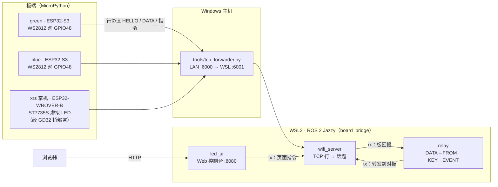
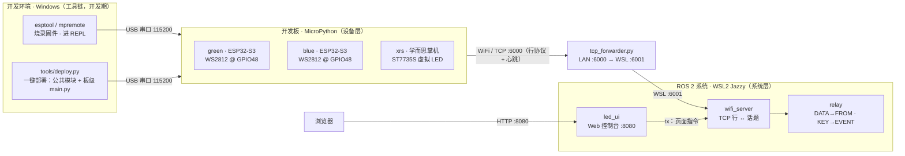
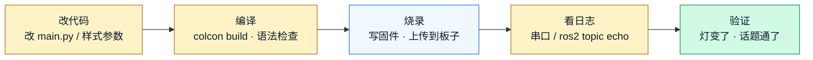
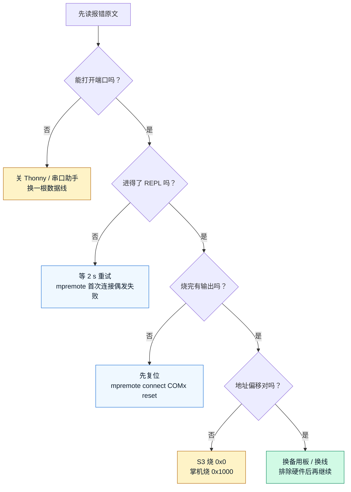
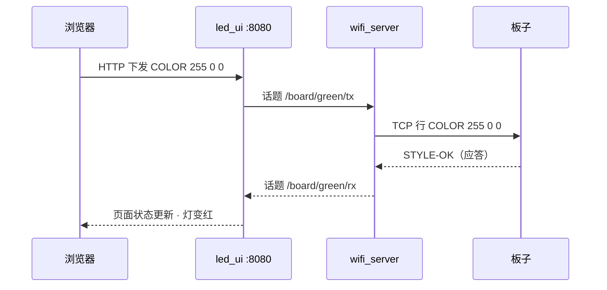

# ESP32 与 ROS 2 开发基础（课程包与三板上位机系统）

结论先行：这是私有仓库 `esp32s3_ros2_3board_1drvboard` 的教学化归档——一套面向职业本科
大一学生的 48 学时软硬件入门课程（课程包）+ 一个可运行的真实工程（三块板经 WiFi/TCP 接入
WSL 里的 ROS 2，Web 控制台管灯效）；2026-10-16 增补**短平快版**（1 天集中教学 +
3–4 天自学实践，约 30 学时，含学生学习手册与 AI 辅助开发，见第六节）。课程包在 `培训/ESP32与ROS2开发基础课程包/`，
代码在 `教学demo/ESP32-ROS2-LED协同系统/`，讲义 deck 在 `教学webppt/ESP32与ROS2开发基础/`。

## 一、系统组成与数据链路



三块板**主动连出**（TCP 客户端）：green / blue 是 ESP32-S3 N16R8（16 MB Flash / 8 MB PSRAM，
板载 WS2812 接 GPIO48）；xrs 是学而思掌机（ESP32-WROVER-B + ST7735S 128×160 屏，无 WS2812，
屏幕显示虚拟 LED），其"1 drvboard"= GD32 USB 串口桥（VID 28E9），`tools/deploy.py` 自动识别
并改用友好 REPL + base64 上传。

### 开发环境与三层链路全景

要区分两层关系：**工具链经 USB 串口作用于板子（开发期）**，**板子经 WiFi/TCP 主动连出接进 ROS 2（运行期）**。



数据流即教学顺序，也是全课主线：设备层（GPIO / WS2812 · MicroPython）→ 通信层（WiFi / TCP /
行协议 / 心跳）→ 系统层（ROS 2 节点 / 话题 / 桥接 / 人机界面）。

### 最小开发闭环：改、编、烧、看、验

从改一行代码到看见结果，只走这五步；顺序固定，哪一步断链就从哪一步查。deck「开发闭环」页同源，
那里是点式动画（默认全亮＝静态兜底）。



记忆锚（全册统一，讲课时反复出现）：

- **口诀**：改、编、烧、看、验——五步不断链。
- **生活化类比**：编译＝做菜备料，烧录＝端上桌，日志＝尝味道；没备料就上桌是空盘，不尝味道不知道咸淡。
- **颜色编码**：蓝＝硬件 / 板子，橙＝代码 / 工具链，绿＝验证通过。

五步不断链：任何一步跳过，后面看到的都不是真实结果。

## 二、硬件与烧录

| 板 | 固件 | 烧录偏移 | 串口 |
| --- | --- | --- | --- |
| ESP32-S3（green/blue） | `firmware/GENERIC_S3-20220618-v1.19.1.bin`（完整镜像） | **0x0** | CH343（VID 1A86 / PID 55D3）115200 |
| 学而思掌机（xrs） | `xrs/firmware/ESP32_GENERIC-SPIRAM-20220618-v1.19.1.bin` | **0x1000** | GD32 桥（VID 28E9，"USB 串行设备"） |

出厂固件是 ESP-IDF 演示（无 Python REPL），必须烧 MicroPython；`xrs/firmware/xrs-stock-backup-4mb.bin`
是掌机原厂 4 MB flash 备份（恢复用）。工具统一 `python -m esptool` / `python -m mpremote`（Scripts 不在 PATH）。

```powershell
python -m esptool --port COM13 --baud 460800 erase-flash
python -m esptool --port COM13 --baud 460800 write-flash -z 0x0 "教学demo/ESP32-ROS2-LED协同系统/firmware/GENERIC_S3-20220618-v1.19.1.bin"
python -m esptool --port COM5  --baud 460800 write-flash -z 0x1000 "教学demo/ESP32-ROS2-LED协同系统/xrs/firmware/ESP32_GENERIC-SPIRAM-20220618-v1.19.1.bin"
```

### 报错排查顺序：先错哪一步

报错不是随机事件——从上到下逐层排除，先定位再动手；一次只改一个变量。deck「报错排查」页同源。



排查口诀：「先看端口、再进 REPL、烧完复位、最后对偏移」——四问都过，才怀疑硬件。

## 三、网络与运行

```powershell
# 本组网络配置：复制模板后填写（wifi_config.py 不入库、不截图、不投屏）
copy common\wifi_config.example.py common\wifi_config.py

# 一键部署（公共模块 + wifi 配置 + 板级 main.py，再单独复位）
python tools\deploy.py COM13 green
python tools\deploy.py COM14 blue
python tools\deploy.py COM5  xrs

# Windows 转发器（WSL 镜像网络拦 LAN→WSL 入站；保持运行）
python tools\tcp_forwarder.py --listen 0.0.0.0:6000 --target 127.0.0.1:6001
```

```bash
# WSL2 全栈
source /opt/ros/jazzy/setup.bash
cd <本目录>/ros2_ws && colcon build && source install/setup.bash
UI_HOST=0.0.0.0 ros2 launch board_bridge wifi.launch.py   # 页面 http://<WSL_IP>:8080
```

关键参数：`SERVER_IP` 填 **Windows 电脑**的局域网 IP（不是 WSL）；WiFi 必须 2.4 GHz；
转发器 `:6000` → `wifi_server :6001`（`WIFI_PORT` 可改）；页面 `UI_PORT` / `UI_HOST`（默认
只绑 `127.0.0.1`，`UI_HOST=0.0.0.0` 会暴露到局域网，仅限隔离实验网）。

## 四、通信协议（行文本，`\n` 分隔）

| 方向 | 行 | 频率/说明 |
| --- | --- | --- |
| 板 → 服务器 | `HELLO <NAME>` | 连接时注册（板名 = green / blue / xrs） |
| 板 → 服务器 | `DATA <NAME> <seq>` | 每 4 s 心跳，序号递增；页面据此判在线（超时 10 s） |
| 板 → 服务器 | `STYLE-OK / STYLE-ERR ...` | 指令应答；`STYLE LIST` 回多行 + `STYLE-END <n>` |
| 服务器 → 板 | `STYLE SET/DEL/USE/LIST`、`PLAY`、`MIX`、`LED/COLOR/PERIOD/PATTERN/RESET` | 见下表 |
| 板 ↔ 板（经 relay） | `FROM <NAME> <seq>`、`EVENT <BOARD> <KEY>` | 心跳与按键转发 |

| 指令 | 语义 |
| --- | --- |
| `STYLE SET <name> <R> <G> <B> <PERIOD_MS> [solid\|blink]` | **只保存不改当前**；`default` 受保护不可覆盖/删除 |
| `STYLE USE <name>` / `STYLE DEL <name>` / `STYLE LIST` | 应用 / 删除 / 查询（回包以 `STYLE-END n` 结束） |
| `PLAY <name> ...` / `PLAY STOP` | 顺序轮播（每样式 4 个周期） |
| `MIX <name> ...` / `MIX STOP` | 并行混合：20 ms 采样，亮灭取 OR、颜色通道相加截断 |
| `LED/COLOR/PERIOD/PATTERN` | 快捷编辑当前样式；`RESET` 回本板默认闪烁（保留自定义样式） |

样式存 RAM，重启清空；`default` 永远健在，所以原始绿/蓝闪烁不会丢。

### 一条改色指令的消息往返

页面下发、桥接转发、板子执行、回包验证——一次改色要走的往返路径；deck「ROS 2 桥接」页同源，
那里是点式动画（默认全亮＝静态兜底）。



## 五、排障速查

| 现象 | 优先检查 | 处理 |
| --- | --- | --- |
| 找不到 COM 口 | USB 线 / 驱动 | 换数据线；装 CH343 驱动；`python -m mpremote devs` |
| `could not open port` | 端口被占用 | 关闭 Thonny / 串口助手 / bridge 后重试 |
| `raw repl` 失败 | mpremote 首次时序 | 等 2 s 重试（`deploy.py` 已内置） |
| 板子反复 `connect failed` | 密码 / 频段 / `SERVER_IP` | 确认 2.4 GHz、IP 是 Windows 的；先用该板串口日志定位 |
| 转发器无连接日志 | 板子没连到 Windows | 核对 `SERVER_IP`；确认 6000 未被占用 |
| WSL 里没有话题 | 没 source / launch 没起 | `source /opt/ros/jazzy/setup.bash` + `source install/setup.bash` |
| 页面打不开 | WSL localhost 不转发 | 用 `hostname -I` 得到 WSL IP 访问；或 `UI_HOST=0.0.0.0` |
| 页面还是旧版 | 浏览器缓存 | `Ctrl-F5`（服务端已加 `no-store`） |
| 指令无响应 | 板子离线 / 拼写 | 看 `wifi_server` 的 `offline, dropping`；指令全大写 |
| 板子重启后样式全没了 | 设计如此 | 样式在 RAM；教学用 `STYLE SET` 重新下发 |

## 六、课程包与相关材料

- 课程包（课程标准 / 16 周单元设计 / 11 个实验指导 / 考核方案 / 教师手册）：
  `培训/ESP32与ROS2开发基础课程包/`——先读其 `README.md`。
- 短平快版（2026-10-16 增补并修订为学生可用课程）：1 天集中教学 + 3–4 天自学实践（约 30 学时），
  目标为独立走通 ROS 2 应用流程 + 在教师监督下用 AI 工具完成本项目算法改造；
  教师用 `06-短平快课程方案.md`（学习目标 / 内容与学时 / 实施 / 考核），
  学生用 `07-学生学习手册.md`（标记图例、知识讲解、五个学习单元、验收清单与记录表、AI 辅助开发方法）。
- 工程代码：`教学demo/ESP32-ROS2-LED协同系统/`（含两块板的固件与 `wifi_config.example.py`）。
- 讲义 deck：`教学webppt/ESP32与ROS2开发基础/`。
- 一键下载（课程包 + 代码 + 固件 zip）：
  [`../教学webppt/ESP32与ROS2开发基础/files/ESP32与ROS2课程包与代码.zip`](../教学webppt/ESP32与ROS2开发基础/files/ESP32与ROS2课程包与代码.zip)

## 七、两套上法：系统学期版 vs 短平快版

同一门课两种上法，按人群与学时选；对照表如下（deck「对比决策」页同源）。

| 维度 | 系统学期版（16 周 / 48 学时） | 短平快版（1 天 + 3–4 天 / 约 30 学时） |
| --- | --- | --- |
| 适合人群 | 职业本科一年级正课、有完整学期排课；要体系、要带班 | 小学期、实训周、竞赛集训前快速入门；有基础 Python 即可 |
| 内容纵深 | 设备 → 通信 → 系统逐层展开，含 git 与固件内部结构 | 保链路、减纵深：点灯编程压为「读懂 + 改参数」，删 git 与固件内部 |
| 核心目标 | 会装 / 会写 / 会连 / 会调 / 会做，覆盖全部知识点 | 走通最小闭环 + 在教师监督下用 AI 做一次算法改造 |
| 考核方式 | 平时 20% + 实验 40% + 综合项目 40% | 验收清单 + 结课演示 + AI 使用记录核查 |
| 主要产出 | 11 个实验记录 + 1 个小组作品（现场演示 + 答辩） | 五个学习单元证据包 + 三个算法任务（至少完成一、二） |
| 主要风险 | 周期长，需整学期排课与实验室机位 | 学时不宽裕、删减多，自学自律要求高 |

引导问题：场景是「整学期系统培养」，还是「几天内把闭环跑通并改一次算法」？先回答它，再决定上哪一套。

- 要体系、要带班、要覆盖全部知识点、有整学期排课与机位 → 选 **系统学期版**，别压缩。
- 只有几天、基础 Python 已会、目标就是走通闭环并改一次算法 → 选 **短平快版**，别硬排 16 周。

## 八、教学法与短平快模式（与 deck 同源）

### 教学环：现象 → 原理 → 动手 → 验收

每节课都完整走一圈：先给能看 / 能玩的结果，再讲原理，然后结对动手，最后当堂验收。


### AI 监督开发：读 → 讲 → 改 → 验

四步缺一不可：不读就改是瞎改，不验就交是赌博。AI 可以帮你写，解释和验证必须自己来。


### 行动节奏

装环境 → 逐周推进 → 第 8 周门禁（`colcon build` 本机可跑）→ 选题与答辩。门禁不过不进入项目阶段。
短平快场景按「1 天集中 + 3–4 天自学 + 结课验收」推进，约 30 学时。
