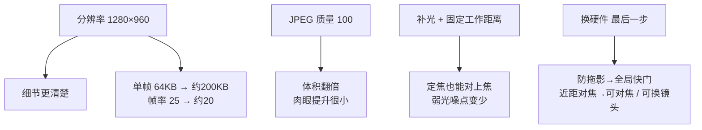
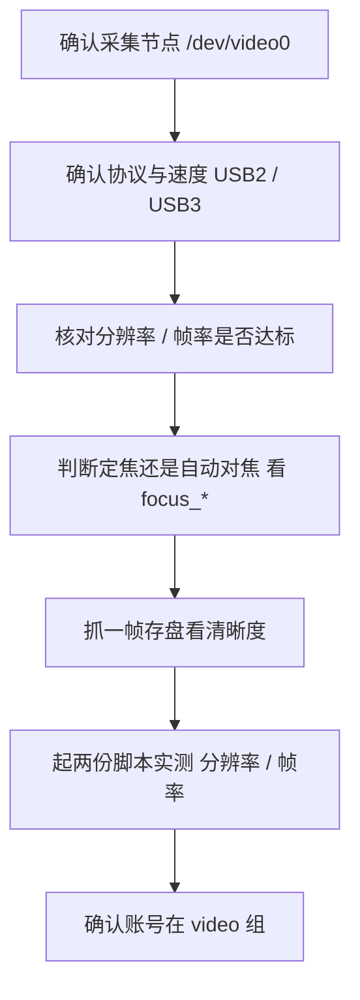

# USB 摄像头参数（新 Pi `zhangsk`）

> 记录本仓库 `教学demo/摄像头远程显示/cam_server.py` / `cam_view.py` 所用摄像头的硬件能力、可调控件与实测性能。
> 数据来源：`v4l2-ctl -d /dev/video0 --list-formats-ext`、`v4l2-ctl -d /dev/video0 --list-ctrls`、实测抓帧。

## 设备识别

| 项 | 值 |
| --- | --- |
| 型号标识 | `HD camera : HD camera`（USB 设备，`usb-xhci-hcd.0-1`） |
| 宿主 | Raspberry Pi 5 `zhangsk`（eth0 `172.26.188.116`） |
| 采集节点 | `/dev/video0`（另有 `/dev/video1`、`/dev/media3`） |
| 类型 | **USB 摄像头**（非 CSI；`rpicam`/libcamera 看不到） |
| 采集方式 | V4L2（OpenCV `cv2.VideoCapture(device, cv2.CAP_V4L2)`，MJPG） |
| 对焦 | **定焦**（无 `focus_absolute` / `focus_auto` 控件，无法软件对焦） |
| 权限组 | `video`（账号 `nanzhida` 已在该组） |

## 支持的格式与分辨率

MJPG（压缩，高分辨率必需）：

| 分辨率 | 帧率档位 |
| --- | --- |
| 1280×960 | 25 / 5 |
| 1280×720 | 25 / 5 |
| 1280×640 | 25 / 5 |
| 1280×480 | 25 / 5 |
| 1024×576 | 25 / 5 |
| 640×480 | 25 / 5 |
| 640×360 | 25 / 5 |
| 320×480 | 25 / 5 |
| 320×240 | 25 / 5 |

YUYV（未压缩，仅低分辨率）：

| 分辨率 | 帧率档位 |
| --- | --- |
| 640×480 | 25 / 5 |
| 352×288 | 25 / 5 |
| 320×240 | 25 / 5 |
| 176×144 | 25 / 5 |

## 可调控件（V4L2，默认值）

| 控件 | 范围 | 默认 | 说明 |
| --- | --- | --- | --- |
| brightness | 0–255 | 138 | 亮度 |
| contrast | 0–255 | 128 | 对比度 |
| saturation | 0–255 | 80 | 饱和度 |
| hue | 0–255 | 128 | 色调 |
| gamma | 0–255 | 0 | 伽马 |
| gain | 0–255 | 136 | 增益 |
| sharpness | 0–63 | 63 | 锐度（默认已最大） |
| backlight_compensation | 0–255 | 136 | 背光补偿 |
| white_balance_automatic | 0/1 | 1 | 自动白平衡 |
| white_balance_temperature | 0–255 | 64 | 白平衡色温（自动时 inactive） |
| power_line_frequency | 0–2 | 0 (Disabled) | 工频抗闪烁 |

> 这些控件是**驱动持久状态**，改一次会一直保留（除非重启/重新设置），不是脚本默认值。

## 软件默认参数（仓库内）

`教学demo/摄像头远程显示/cam_server.py`（Pi 端）：

| 参数 | 默认 | 备注 |
| --- | --- | --- |
| `--device` | 0 | `/dev/video0` |
| `--width` / `--height` | 640 / 480 | 原默认；最高可到 1280×960 |
| `--fps` | 30 | 硬件实际封顶 25 |
| `--quality` | **100** | JPEG 质量，已到上限 |
| `--port` | 5000 | |
| `--bind` | 172.26.188.116 | 新 Pi eth0 静态地址 |

`教学demo/摄像头远程显示/cam_view.py`（本机）：

| 参数 | 默认 |
| --- | --- |
| `--host` | 172.26.188.116 |
| `--port` | 5000 |
| `--frames` | 0（不停止） |
| `--check` | 关闭 |

## 实测性能（1G 直连，JPEG 质量 100）

| 分辨率 | 单帧大小 | 帧率 |
| --- | --- | --- |
| 640×480 | ~64 KB | 25–27 |
| 1280×960 | ~193–215 KB | 19–24 |

## 参数-效果对应（改一个参数，画面就变一个样）



> 颜色编码（全册一致）：🔵 蓝＝设备 / 硬件、🟠 橙＝软件 / 参数、🟢 绿＝验证通过。分辨率和质量是「甜蜜的负担」，补光与固定距离才是定焦镜头的解药。

## 换机 / 到货后核对流程



验收点：分辨率 / 帧率达标，且对焦能满足实际工作距离。

## 能力上限与取舍

- **分辨率**上限 **1280×960**（MJPG）；YUYV 最高只有 640×480。
- **帧率**上限 **25 fps**（所有分辨率，硬件固定档位 25/5）。
- **JPEG 质量**上限 **100**；90→100 肉眼提升很小、体积翻倍，且会掉帧（1280×960 下约 25→20 fps）。
- 带宽不是瓶颈：1280×960×质量100 ≈ 5 MB/s，远低于 1 Gbps。
- 定焦镜头：近距离小字发虚无法靠软件解决，需拉开到对焦距离或换更高分辨率/自动对焦摄像头。

## 常用命令

```bash
# 装工具（首次）
sudo apt-get install -y v4l-utils

# 列出设备与驱动
v4l2-ctl --list-devices
dmesg | grep -i uvc          # 例：Found UVC 1.00 device HD camera

# 列出支持的分辨率/帧率
v4l2-ctl -d /dev/video0 --list-formats-ext

# 当前格式
v4l2-ctl -d /dev/video0 --get-fmt-video

# 查看/设置控件
v4l2-ctl -d /dev/video0 --list-ctrls
v4l2-ctl -d /dev/video0 --set-ctrl=brightness=138,contrast=128,gamma=0

# 设分辨率与像素格式（MJPG）
v4l2-ctl -d /dev/video0 --set-fmt-video=width=1280,height=960,pixelformat=MJPG

# 抓一帧存盘
v4l2-ctl -d /dev/video0 --stream-mmap --stream-count=1 --stream-to=frame.jpg

# 两个脚本都在 教学demo/摄像头远程显示/ 目录下运行
# Pi 端启动（默认 640×480 / 质量100 / bind 172.26.188.116）
python3 cam_server.py
# 最高采集
python3 cam_server.py --width 1280 --height 960 --quality 100 --fps 25

# 本机显示（默认 host 172.26.188.116）
python cam_view.py
# 只验证不弹窗
python cam_view.py --check --frames 30
```

退出显示窗口：按 `q` 或 `Esc`。
