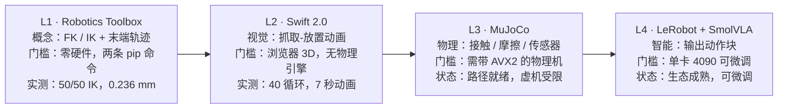

# 机器人入门复现路线

「只选一个机器人入门项目选哪个」的路线教程（文字版），配套 deck：`教学webppt/机器人入门复现路线/`（单文件成品）。素材来自 `培训/机器人入门-复现路线评估/`（2026-09-29，含实测报告与证据），L1 / L2 为整理者本机实测，L3 的 MuJoCo 结论受其虚机环境限制（非路线问题）。

## 1. 结论先行

- **值得，A-，是当前条件下最优的单一入门路线**：不靠读文档对比，L1 与 L2 已在本机全流程跑通，Swift 2.0 的坑也踩完。
- **零硬件起步**：两条 pip 命令（`roboticstoolbox-python` + `swift-sim`）就能跑通 FK / IK 与可视化。
- **台阶连续**：IK → 轨迹 → 可视化 → 物理 → 真机 / VLA，每步都踩在前一步上；每 1–2 天就有一个「能给别人看」的产出。
- **终点可达**：可接 SmolVLA（约 450M，4090 单卡可微调），不是玩具路线。
- **核心减分项**：Swift 无物理引擎，「抓取」是位姿贴合而非真实接触——这恰好把学生「逼」进 MuJoCo，迁移动机天然成立。

## 2. 训练阶梯全景



每一级只依赖上一级，且各自都能独立交付；门槛决定你从哪一级起跑。

| 层 | 做什么 | 工具 | 本机实测 |
| --- | --- | --- | --- |
| L1 | FK / IK 与末端轨迹（纯计算） | Robotics Toolbox（Python） | 全过：50/50 IK，0.236 mm |
| L2 | 可视化与动作演示 | Swift 2.0 | 全过：40 循环抓取-放置动画 |
| L3 | 真实物理接触与传感器 | MuJoCo（Menagerie 模型） | 路径就绪；本机受虚拟化限制 |
| L4 | 模仿学习 / VLA 输出动作 | LeRobot + SmolVLA（约 450M） | 生态成熟，单卡 4090 可微调 |

## 3. L1 · Toolbox FK/IK：数字先跑通

依赖版本（python 3.12 venv + 清华源）：

| 包 | 版本 |
| --- | --- |
| roboticstoolbox-python | 1.4.4 |
| swift-sim | 2.0.1 |
| spatialmath-python | 1.1.18 |
| numpy | 2.5.3 |

Panda 模型 FK/IK + 末端圆轨迹实测：IK 收敛 **16 次迭代**、关节残差 **1e-8**；50 点笛卡尔圆轨迹逐点 IK **50/50 成功**，平均末端误差 **0.236 mm**。

完整环境与运行命令：

```bash
# 环境（python 3.12 venv + 清华源）
uv venv rtb-venv --python 3.12
uv pip install --python rtb-venv/bin/python \
    roboticstoolbox-python swift-sim spatialmath-python \
    -i https://pypi.tuna.tsinghua.edu.cn/simple

# L1：FK/IK + 轨迹（纯计算，秒出结果）
rtb-venv/bin/python smoke/rtb_smoke.py
```

## 4. L2 · Swift 可视化：完整抓取-放置动画

- 服务结构：HTTP **52000** / WebSocket **53000**；浏览器端 3D 渲染正常，时钟随仿真推进。
- 6 个关键位姿：方块上方悬停 → 抓取位 → 抬起 → 目标垫上方 → 落位 → 撤离，**IK 全部 success**；40 个循环持续演示。
- 录制证据：70 帧 CDP 连拍 → 合成 **7 秒动画**（1280×606）；四帧拼图与关键帧见 evidence。
- 实测节奏：步进随浏览器帧同步浮动（约 0.03–0.3 s/步），做长演示时按需调参即可。

## 5. L3 · MuJoCo：路径就绪，本机栽在虚拟化

- **现象**：MuJoCo 3.14.0 / 3.2.6 / 3.0.1 三个版本在本机均 **SIGILL**（非法指令，核心转储）。
- **根因（已查明）**：本机是 QEMU 虚拟机，CPU 为 `QEMU Virtual CPU version 2.5+`，未透传 AVX / AVX2 / FMA / BMI2 / AVX-512（`/proc/cpuinfo` 全为 NO）；新版 MuJoCo 官方 wheel 按 x86-64-v3 基线构建，无 AVX2 直接崩。
- **结论**：不是路线问题，是环境限制。物理机（2013 年后主流 CPU 均带 AVX2）正常；低配虚机需 CPU 直通 / 换基线构建 / 指定旧版 wheel。
- **生态核实**：MuJoCo Menagerie 含 Panda 与与 SmolVLA 对齐的 SO-101 场景。
- **迁移要点**：Toolbox 学的 IK / 轨迹概念原样保留；MuJoCo 增加的是物理接触（抓取要保持、接触力、摩擦）与传感器仿真；接口就是 `mj_step`，模型可直接取 Menagerie 的 panda XML。

## 6. L4 · VLA：生态比预想成熟，单卡可行

- **目标形态：动作块（action chunk）**——VLA 的输出通常是末端位姿增量 / 关节目标序列，正好接在阶梯上一级的控制器上。
- **建议顺序**：先小规模模仿学习（ACT / Diffusion Policy）建立「数据 → 训练 → 闭环」直觉，再上 SmolVLA；仿真侧可用 LIBERO / robosuite 做 benchmark。

| 组件 | 结论 |
| --- | --- |
| LeRobot + SmolVLA（约 450M） | 官方教程确认单卡 4090 可微调 |
| SO-101 机型 | Menagerie 有对齐模型，仿真可复现 |
| LIBERO / robosuite | benchmark 与数据管线现成 |
| Robotics Toolbox / Swift / RVC3 | 仓库持续维护，学习路线锚点稳定 |

## 7. 对比决策：逐级推进还是定向跳级

| 维度 | 逐级推进（推荐） | 定向跳级（速览） |
| --- | --- | --- |
| 前置依赖 | 每级只依赖上一级，L1 概念直接迁移到 L3 / L4 | 跳过 L1 / L2 直接上 MuJoCo / VLA，得先补 IK、轨迹与数据概念 |
| 失败可归因 | 出错只可能来自当前一级，排查面窄 | 物理 / 数据问题与概念缺口混在一起，难定位 |
| 产出节奏 | 每 1–2 天一个可见产出（数字 → 图 → 动画） | 首个产出来得晚，容易在中途失去反馈 |
| 适合人群 | 零基础学生、课程 / 竞赛队统一训练 | 已有 ROS / Python 基础、只想快速探边界的人 |
| 主要风险 | 线性推进，总时长按里程碑叠加 | 概念缺口在 L3 / L4 集中爆发，返工成本高 |

引导问题：你的目标是「两周内交出一份能演示的成果」，还是「先把整条链路摸一遍」？先回答它，再决定从哪一级起跑。

## 8. 为什么优于其它入门选择

| 备选路线 | 相对劣势 |
| --- | --- |
| pybullet 起步 | 更偏「调物理参数」，工具链直觉弱于 Toolbox 的教科书体系 |
| panda-gym / robosuite / LIBERO | 面向 RL / benchmark，入门者要先补 RL 概念，门槛前置 |
| 直接上 MoveIt2 / ROS 2 | 环境重、概念多（中间件 / 坐标系 / 控制器），最容易劝退 |
| 直接买真机机械臂 | 成本 + 硬件故障噪声淹没概念学习 |

本路线用「教科书体系 + 每层可见产出」换掉「一上来就补 RL / ROS 概念」的门槛；L1 / L2 的坑已排完，学生照做即可复现。

## 9. 里程碑与时间预算（学生口径）

| 里程碑 | 内容 | 预算 |
| --- | --- | --- |
| M0 | 环境（venv + 两个包） | 约 1 小时 |
| M1 | FK / IK（跟 RVC3 章节） | 1–2 天 |
| M2 | 末端轨迹 + Swift 动画（本 deck 已示范至此） | 1 天 |
| M3 | MuJoCo 真实抓取（接触保持） | 1–2 周 |
| M4 | ROS 2 / MoveIt2 | 1–2 周 |
| M5 | 模仿学习 / VLA（4090 单卡） | 2–4 周 |

排期建议：到 M2 约一周即可有一次完整演示（数字 → 动画）；M3 起进入「物理 + 真机」阶段，按实验室机位排期。

## 10. 坑清单（Swift 2.0 实测，建议直接写进讲义）

1. **`headless=True` 的语义**：它完全不启动前端（纯仿真）——想可视化必须不带 headless。第一次踩会以为「服务起来了但页面空白」。
2. **约 10 秒「握手窗口」**：`launch()` 后浏览器必须在约 10 秒内连上；否则迟到的握手消息会串进 `step()` 的事件处理，主线程以 `KeyError: 'event'` 崩溃（服务器线程变僵尸：端口还在、连接全断）。
3. **单客户端纪律**：同一场景同一时间只允许**一个**浏览器标签页连接；第二个客户端（含残留旧标签）的握手会把场景搞崩——重启场景前先关旧标签。
4. **无头截图正确姿势**：一次性 `chrome --screenshot`（虚拟时间）会拍空（显示 Disconnected / 空白）；要用 CDP 常驻浏览器方案。另：升级 swift-sim 后前端有 `js_version` 校验，需硬刷新页面。

## 11. 复现快捷指引（本机实测命令）

```bash
# 1) 环境
uv venv rtb-venv --python 3.12
uv pip install --python rtb-venv/bin/python \
    roboticstoolbox-python swift-sim spatialmath-python \
    -i https://pypi.tuna.tsinghua.edu.cn/simple

# 2) L1：FK/IK + 轨迹（纯计算，秒出结果）
rtb-venv/bin/python smoke/rtb_smoke.py

# 3) L2：一键起场景（demo 先起，1 秒后 chrome 接入 —— 顺序不可换）
bash smoke/run_scene4.sh        # 内含 40 循环抓取-放置动画
rtb-venv/bin/python smoke/shot_cdp.py out.png 2 9225      # 单帧
rtb-venv/bin/python smoke/capture_frames.py 70 0.75       # 连拍
ffmpeg -y -framerate 10 -i swift_frames/f_%03d.png -vf "scale=1280:-2" \
    -c:v libx264 -crf 27 -pix_fmt yuv420p anim.mp4        # 合成动画
```

脚本目录：`~/projects/robot-entry-recon/smoke/`（`rtb_smoke.py` / `swift_demo4.py` / `run_scene4.sh` / `shot_cdp.py` / `capture_frames.py`）。**脚本未随包分发**，照抄前按自己环境改路径。环境要点：本机 `uv` 在 `~/.hermes/bin/uv`；pip 走清华源；python 3.12。

## 12. 生态核查（2026-09-28/29 联网核实）

- **Robotics Toolbox / Swift**：仓库近期持续提交；Swift 9 月刚发 **2.0** 大版本（本次实测 2.0.1）。
- **RVC3-python**：官方教材配套代码库正常维护（学习路线锚点）。
- **LeRobot / SmolVLA / LIBERO / robosuite / panda-gym / openvla / openpi**：均在活跃维护。
- **MuJoCo Menagerie**：含 Panda、SO-101 等场景，可直接取用。

## 13. 行动清单

| 优先 | 动作 | 预算 / 入口 |
| --- | --- | --- |
| 1 | 装环境：python 3.12 venv + 两条 pip 命令 | 约 1 小时（M0） |
| 2 | 跟 RVC3 章节做 FK / IK | 1–2 天（M1） |
| 3 | 复现 L2 抓取-放置动画 | 1 天（M2），命令见 §11 |
| 4 | 上物理机装 MuJoCo，接 Menagerie 的 panda XML | 1–2 周（M3） |
| 5 | 接 ROS 2 / MoveIt2，再上模仿学习 / VLA | 1–2 周 + 2–4 周（M4 / M5） |

延伸入口：评估报告 `培训/机器人入门-复现路线评估/机器人入门复现路线评估-20260929.md`；工具锚点 `petercorke/robotics-toolbox-python`、`petercorke/rvc3python`、`google-deepmind/mujoco_menagerie`、`huggingface/lerobot`。

## 下载与延伸

- 评估报告 + 证据（zip）：`教学webppt/机器人入门复现路线/files/机器人入门路线评估-20260929.zip`
- 实测动画：`教学webppt/机器人入门复现路线/files/swift_grab_anim.mp4`（7 秒，1280×606）
- 本文字版：`教学webppt/机器人入门复现路线/files/机器人入门复现路线-文字版教程.md`
- 仓库内延伸：`docs/ROS2与micro-ROS选型.md`、`教学webppt/树莓派连接与部署/`（L3 之后接真机与 ROS 2）。
