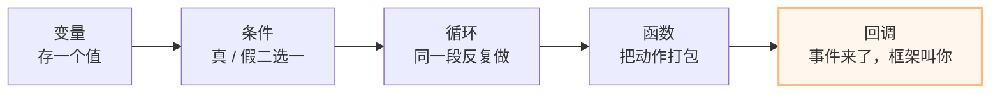
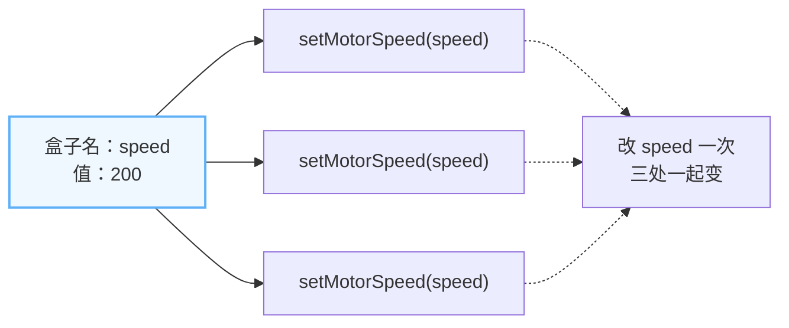
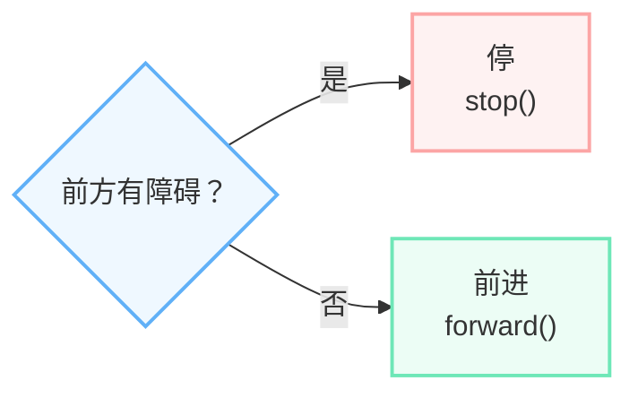
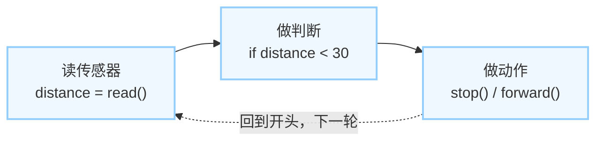
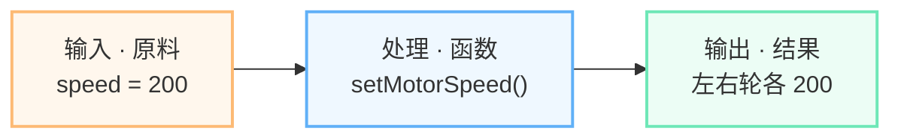
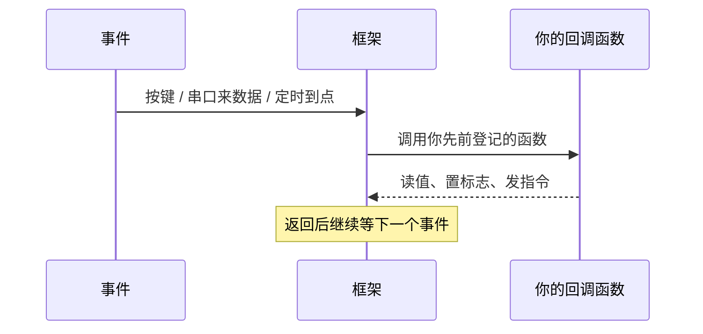
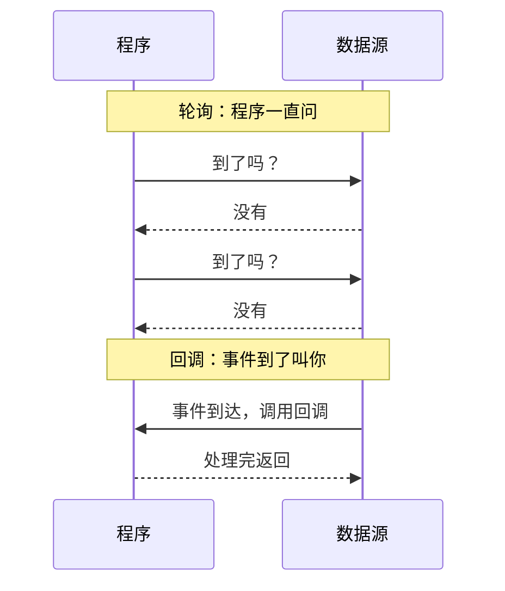
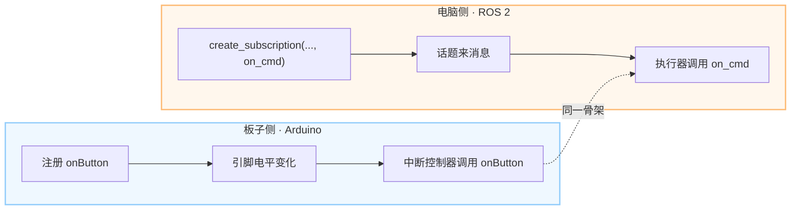
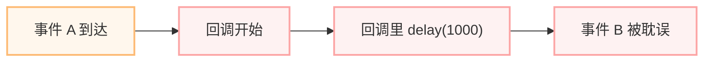

# 编程零基础起步：从函数到回调

> 先修课（第 0 册）。面向没有编程基础的学生，建议在《ESP32 与 ROS 2 开发基础》之前学。
>
> 对应 deck：[教学webppt/编程零基础起步/index.html](../教学webppt/编程零基础起步/index.html)  
> 文字版教程：[编程零基础起步-文字版教程.md](../教学webppt/编程零基础起步/files/编程零基础起步-文字版教程.md)

## 一句话结论

编程不可怕：会照着改，就先成功一半。本册只抓 5 个最小概念——变量、条件、循环、函数、**回调**；其余语法用到再查。

## 1. 五个概念怎么拼起来



前四个是积木，回调是让积木在正确时机自动启动的开关。机器人程序再复杂，也基本是这五样拼起来的。

| 概念 | 一句话 | 在机器人里的样子 |
| --- | --- | --- |
| 变量 | 贴了名字的盒子 | `speed = 200`、`distance`、`stop_flag` |
| 条件 | 红绿灯式二选一 | `if distance < 30: stop()` |
| 循环 | 同一段反复做 | `while True:` 一直读传感器 |
| 函数 | 配方 / 工具 | `setMotorSpeed(200)` |
| 回调 | 事件来了，框架叫你 | 按键中断、串口接收、ROS 2 订阅 |

## 2. 变量：贴了名字的盒子

`speed = 200` 把 200 放进名为 `speed` 的盒子。以后要用速度，就写 `speed`，不再到处抄 200。



```python
speed = 200          # 把 200 放进 speed 这个盒子
setMotorSpeed(speed) # 用盒子里的值，而不是再写一遍 200
```

要点：

- 名字写「它是什么」：`speed`、`distance`、`threshold`、`stop_flag`。
- 同一个名字只放一类值：速度别一会儿放 200，一会儿放「前方有障碍」。
- 先赋值再使用：盒子还没放东西就读，程序会报错或读到奇怪的值。
- `=` 是「放进去」（赋值）；`==` 是「问相不相等」（比较）。判断里写成 `=` 是初学者最常见的错。

## 3. 条件：红绿灯式二选一

条件只回答一个问题：真，还是假。真就走一条路，假就走另一条路。



```python
if distance < 30:
    stop()
else:
    forward()
```

读法：「如果 距离小于 30，就 停；否则 前进。」

要点：

- 缩进的行属于 `if`；没缩进的行已经出了判断。
- 常用比较符：`<` 小于、`>` 大于、`==` 等于、`!=` 不等于。
- 条件不是「让机器思考」，而是你提前替它把两条路都写好。

## 4. 循环：机器人程序几乎都住在循环里

传感器每时每刻都在变，程序不能跑一遍就结束；读 → 判断 → 动作，一轮接一轮。



```python
while True:
    distance = read_distance()
    if distance < 30:
        stop()
    else:
        forward()
```

要点：

- 机器人要一直值班：这次没障碍，不代表下一秒也没有。
- 一轮只做一轮的事：读一次、判断一次、动作一次；下一轮重新读。
- 循环里别死等：长 `delay()` 或长循环会让机器人「看不见」这段时间；要等，也用状态机而不是堵住。

## 5. 函数：配方 / 工具

把一段常用动作打包，起个名字；以后给不同的原料，就能重复用。



```python
def setMotorSpeed(speed):
    left_motor.run(speed)
    right_motor.run(speed)

setMotorSpeed(200)   # 调用：把 200 作为原料交给函数
```

要点：

- 三个词就够：函数名（做什么）、参数（给什么）、返回值（交出什么）。本册先盯前两个。
- 现在只要求会调用、会改参数；函数体先照抄，不要求独立写。
- 函数我来调——这是全册口诀的前半句。

## 6. ★ 回调：不是你调它，是事件来叫它

门铃响 → 你起身 → 开门。代码里：事件发生 → 框架调用你写好的函数。



门铃类比：

| 生活 | 代码 |
| --- | --- |
| 门铃响 | 事件发生 |
| 你起身 | 框架调用 |
| 开门 | 你的回调函数执行 |
| 一直站门口问「有人吗」 | 轮询（不是回调） |

```python
def on_button():      # 你写的函数
    pressed = True

register(on_button)   # 交给框架登记
# 事件来了，框架替你调 on_button()
```

要点：

- 你只负责写函数、登记函数；等事件是框架的事。
- 回调函数不是你来调用的，是事件发生时框架替你调用。
- 口诀：**函数我来调，回调他来调**。

## 7. ★ 回调 vs 轮询

两种方式都能拿到数据，区别在「谁掌握节奏」：你一直问，还是事件到了叫你。



| 维度 | 轮询 | 回调 |
| --- | --- | --- |
| 响应速度 | 看问的间隔；间隔长就慢 | 事件一到就叫，通常更快 |
| CPU 占用 | 一直问，没事也白转 | 没事时不占，事件来了才跑 |
| 写法难度 | 直白：一个循环问到底 | 要多想一步：函数谁来调 |
| 适用场景 | 简单脚本、状态变化慢、教学演示 | 按键、串口、传感器中断、ROS 2 订阅 |

轮询不是错，只是要看场合；按键、串口、ROS 2 订阅更适合回调。

## 8. ★ 同一个回调，两种现场

名字不同，骨架一样：先注册函数，事件发生时框架调用它。



板子侧（蓝色）：

```cpp
attachInterrupt(
  digitalPinToInterrupt(2),
  onButton,
  FALLING);

void onButton() {
  pressed = true;   // 只置标志，马上返回
}
```

电脑侧（橙色）：

```python
self.create_subscription(
  String, 'cmd', self.on_cmd, 10)

def on_cmd(self, msg):
    self.last = msg.data

self.create_timer(0.5, self.on_timer)
```

| 现场 | 事件 | 谁调用你的函数 | 常见名字 |
| --- | --- | --- | --- |
| 板子侧 | 引脚电平变化、串口来数据 | 中断控制器 / 串口框架 | 中断回调、串口接收回调 |
| 电脑侧 | 话题来消息、定时器到点 | 执行器（executor） | 订阅回调、定时器回调 |

换的是现场，不换的是「框架替你叫函数」。

## 9. 回调的坑：别在里面死等

回调不是「你的私人函数」，它运行在框架的线程 / 循环里；你一堵，别人也走不动。



错误写法：

```cpp
void onButton() {
  delay(1000);       // 框架被卡住 1 秒
  motor.stop();
}
```

正确写法：

```cpp
volatile bool stopFlag = false;

void onButton() {
  stopFlag = true;   // 只记一笔，马上返回
}

void loop() {
  if (stopFlag) {
    motor.stop();
    stopFlag = false;
  }
}
```

三条红线：

- 不 `delay()` / `sleep()`；
- 不写长时间 `for` / `while`；
- 不在回调里做慢速网络请求或大段打印。

一句话记法：回调只做三件事——**收下、记下、马上返回**；重活交给主循环或状态机。

## 10. 记忆锚：一句口诀、一个门铃、四种颜色

| 钩子 | 内容 | 怎么用 |
| --- | --- | --- |
| 口诀 | **函数我来调，回调他来调** | 我主动写名字调用的是函数；事件来了由框架调用的是回调 |
| 门铃类比 | 门铃响 → 你起身 → 开门 | 门铃＝事件，起身＝框架调用，开门＝回调函数 |
| 颜色编码 | 蓝＝框架 / 板子侧；橙＝你写的代码 / 电脑侧；黄＝事件；绿＝验证通过 | 全册统一，看到颜色就知道角色 |

> 函数我来调，回调他来调；门铃一响，框架叫你。

## 11. 对比决策：先背语法，还是先跑通再回头补？

| 维度 | 先背语法 | 先跑通再回头补 |
| --- | --- | --- |
| 起步速度 | 慢：要背完才敢动 | 快：当天就能看到现象 |
| 记忆效果 | 脱离场景，容易忘 | 挂在现象上，记得住 |
| 遇到新问题 | 容易卡在「这个没学过」 | 会查、会改、会验证 |
| 适合人群 | 有考试大纲、时间充裕、要系统打底 | 零基础、项目驱动、先建立信心 |
| 主要风险 | 背完不会用，挫败感高 | 基础不牢，需要安排回头补 |

引导问题：你今天的硬目标是哪一种？

- 要考试默写 → 先背语法；
- 要让轮子转起来、让消息通 → 先跑通最小闭环，再回头补。

本课程立场：**先跑通、边做边补**；每跑通一次，回头补一个概念。

## 12. 行动清单：今天就能做的 3 件事

1. **抄一段**：把下面的伪代码抄进编辑器，先让它不报错；抄的时候把每一行读成一句人话。
2. **改一个数**：把 `speed = 200` 改成 100 或 300，把 `distance < 30` 改成 50；一次只改一个。
3. **看它变**：记录「改前 / 改后」各一句：哪一行改了、现象怎么变、为什么。

```python
speed = 200
stop_flag = False

def on_button():        # 回调：事件来了框架叫你
    stop_flag = True

register(on_button)     # 先登记，等事件

while True:             # 循环：一直值班
    distance = read_distance()
    if stop_flag or distance < 30:   # 条件：真 / 假
        stop()
    else:
        setMotorSpeed(speed)         # 函数：给参数
```

上面是伪代码，能读懂每一行就够；下一册会把它变成真实的板子程序与 ROS 2 节点。

## 13. 延伸入口

- 下一册：[ESP32 与 ROS 2 开发基础](../教学webppt/ESP32与ROS2开发基础/index.html)
- 本册成品：[教学webppt/编程零基础起步/index.html](../教学webppt/编程零基础起步/index.html)
- 本册文字版：[编程零基础起步-文字版教程.md](../教学webppt/编程零基础起步/files/编程零基础起步-文字版教程.md)
- 相关主题：`ESP32-S3电机驱动板`、`ESP32-S3接入micro-ROS`、`ROS2与micro-ROS选型`

> 先有概念，再上板子；先跑通，再补原理。
