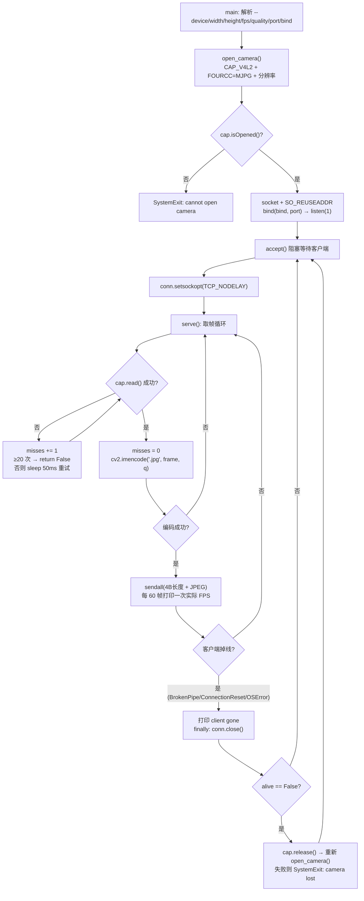
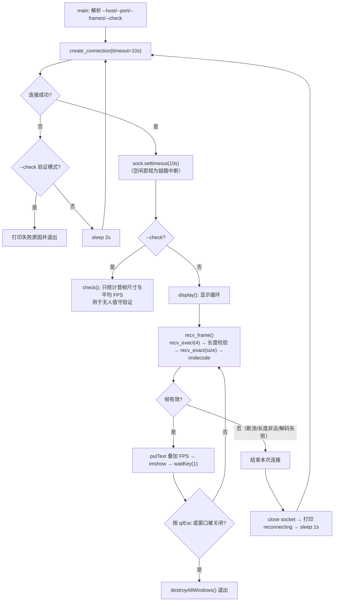
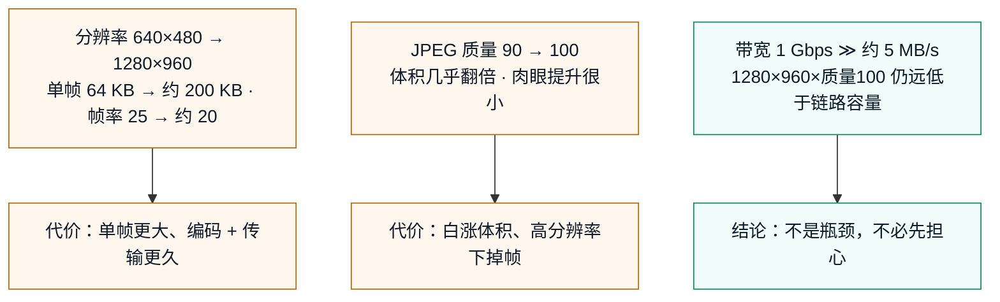
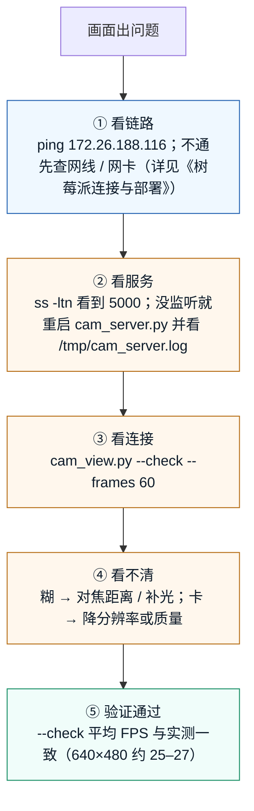

# 树莓派摄像头远程显示 · 程序设计原理流程图

采集与显示解耦为两个进程：树莓派端 `教学demo/摄像头远程显示/cam_server.py`（OpenCV 取帧 → JPEG → 裸 TCP 推送），本机端 `教学demo/摄像头远程显示/cam_view.py`（收帧 → `cv2.imdecode` → `imshow`），中间用「4 字节大端长度 + JPEG 载荷」的帧协议，任一侧异常都不会拖垮另一侧。

## 0. 端到端视频链路（全貌）

画面从摄像头走到屏幕上，是五步一条链；**任一环都能单独定位、单独替换**，不必推翻整条链路。配套讲义里这条链做成了点式动画：讲一步、亮一步（灯走到哪，流程就记到哪）。


口诀：**清不清看带宽，卡不卡看链路**——先看画面糊不糊，再看链路卡不卡。颜色编码全册一致：🔵 蓝＝设备 / 摄像头，🟠 橙＝网络 / 参数，🟢 绿＝验证通过。

## 1. 总体架构与数据流


## 2. 树莓派端服务流程（cam_server.py）



## 3. 本机端显示与重连流程（cam_view.py）



## 4. 关键设计点

| 设计点 | 目的 |
|---|---|
| 采集（Pi）/ 传输（TCP）/ 显示（本机）分层 | 摄像头驱动与图形界面不必同机，Pi 无需联网、无需 GUI |
| 4 字节大端长度前缀 | 在字节流上切分帧边界，客户端无需解析 HTTP/MJPEG 容器 |
| MJPG 采集 + JPEG quality=100 | 用 UVC 硬件压缩降低 USB 带宽，再压一次控制以太网流量（640×480 下约数十 KB/帧） |
| 单客户端 `listen(1)` + `accept` 主循环 | 帧率优先，不引入多路复用；换客户端只需重新 `accept` |
| `TCP_NODELAY` | 关闭 Nagle，避免小帧被延迟合并，压低端到端延迟 |
| 读写两侧都设上限与超时 | 10 s 空闲超时、8 MiB 帧长上限、20 次读帧重试，防止不可信输入或瞬时抖动拖死进程 |
| 断线自动重连（客户端）/ 摄像头自动重开（服务端） | 单侧重启或 USB 抖动后无需人工干预即可恢复 |
| `--bind` 默认绑定 eth0 地址 | 避免 wlan0 接入热点时把未鉴权的画面暴露给同网段设备 |

## 5. 运行方式

```powershell
# 1) 上传并启动服务（脚本位于 教学demo/摄像头远程显示/，用 tools/pi.py 上传）
python tools/pi.py --put cam_server.py /home/nanzhida/cam_server.py
python tools/pi.py --sudo "apt-get install -y python3-opencv"
python tools/pi.py "nohup python3 cam_server.py --bind 172.26.188.116 > /tmp/cam_server.log 2>&1 &"
python tools/pi.py "ss -ltn | grep 5000"        # 确认监听
python tools/pi.py "tail -n 20 /tmp/cam_server.log"

# 2) 本机端（在 教学demo/摄像头远程显示/ 目录下运行；窗口实时显示，q / Esc 退出）
pip install opencv-python numpy
python "教学demo/摄像头远程显示/cam_view.py" --host 172.26.188.116

# 3) 无窗口验证（脚本化 / 无人值守）
python "教学demo/摄像头远程显示/cam_view.py" --check --frames 60

# 4) 要最高采集
python3 cam_server.py --width 1280 --height 960 --quality 100 --fps 25
```

服务端脚本也可写成纯 ASCII 的 `.sh` 用 `python tools/pi.py --file start_cam.sh` 执行（`start_cam.sh` 内即上面的 `nohup … &` 一行）。结果：`/tmp/cam_server.log` 中出现 `listening on 172.26.188.116:5000`。

注意：树莓派重启后 Pi 上的 `/home/nanzhida/cam_server.py` 与后台进程都会丢失，需重新上传并启动。

## 6. 参数与默认值

`cam_server.py`（Pi 端）：

| 参数 | 默认 | 备注 |
| --- | --- | --- |
| `--device` | 0 | `/dev/video0` |
| `--width` / `--height` | 640 / 480 | 最高可到 1280×960 |
| `--fps` | 30 | 硬件实际封顶 25 |
| `--quality` | 100 | JPEG 质量 0–100，已到上限 |
| `--port` | 5000 | |
| `--bind` | 172.26.188.116 | 新 Pi eth0 静态地址；默认绑 eth0 避免 wlan0 暴露画面 |

`cam_view.py`（本机）：

| 参数 | 默认 | 备注 |
| --- | --- | --- |
| `--host` | 172.26.188.116 | 服务端地址 |
| `--port` | 5000 | 服务端端口 |
| `--frames` | 0（不停止） | 收够 N 帧后退出 |
| `--check` | 关闭 | 无窗口模式，无人值守验证 |

退出码：`0` = 正常退出 / `--check` 校验通过，非 `0` = 连接或校验失败；显示窗口按 `q` 或 `Esc` 退出。

## 7. 能力上限与取舍（实测）

| 项 | 结论 |
| --- | --- |
| 分辨率上限 | 1280×960（MJPG）；YUYV 最高只有 640×480 |
| 帧率上限 | 25 fps（所有分辨率，硬件固定档位 25/5） |
| JPEG 质量 | 上限 100；90→100 肉眼提升很小、体积翻倍，1280×960 下掉帧（约 25→20） |
| 带宽 | 不是瓶颈：1280×960×质量100 ≈ 5 MB/s，远低于 1 Gbps |
| 延迟取舍 | 分辨率 / 画质越高，单帧越大、编码与传输越久，端到端延迟越高 |
| 定焦镜头 | 近距离小字发虚无法软件解决，需拉开到对焦距离或换自动对焦摄像头 |

实测性能（1G 直连，JPEG 质量 100）：640×480 约 64 KB/帧、25–27 fps；1280×960 约 193–215 KB/帧、19–24 fps。详见 `docs/摄像头参数.md`。

## 8. 延迟三因素（分辨率 / 编码质量 / 带宽）

决定画面与延迟的其实是三个旋钮。分辨率与编码质量一调高，单帧立刻变大、端到端延迟跟着涨；而带宽根本不是瓶颈。



类比水管：**管径＝分辨率**（管越粗、水越多）、**水压＝带宽**（压力足才流得动）、**漏水＝丢包**（漏一处后面全虚）。链路任一段变细，整套就跟着变细。

## 9. 连不上 / 看不清 排查顺序

出了画面问题别乱试，按顺序走一条链：先确认链路通、服务在、连得上，再处理「看不清」——**先带宽、后链路**，链路不通时调分辨率 / 质量都是白费。



## 10. 记忆锚（口诀 / 生活化类比 / 颜色编码）

- **口诀**：**清不清看带宽，卡不卡看链路**——先带宽、后链路依次排查：画面糊先查分辨率与带宽占用，画面卡先查链路延迟、超时与丢帧。
- **生活化类比**：**视频流＝水管**——管径＝分辨率、水压＝带宽、漏水＝丢包；链路任一段变细，整套就跟着变细。
- **颜色编码**（与讲义图示一致）：🔵 蓝＝设备 / 摄像头，🟠 橙＝网络 / 参数，🟢 绿＝验证通过。
