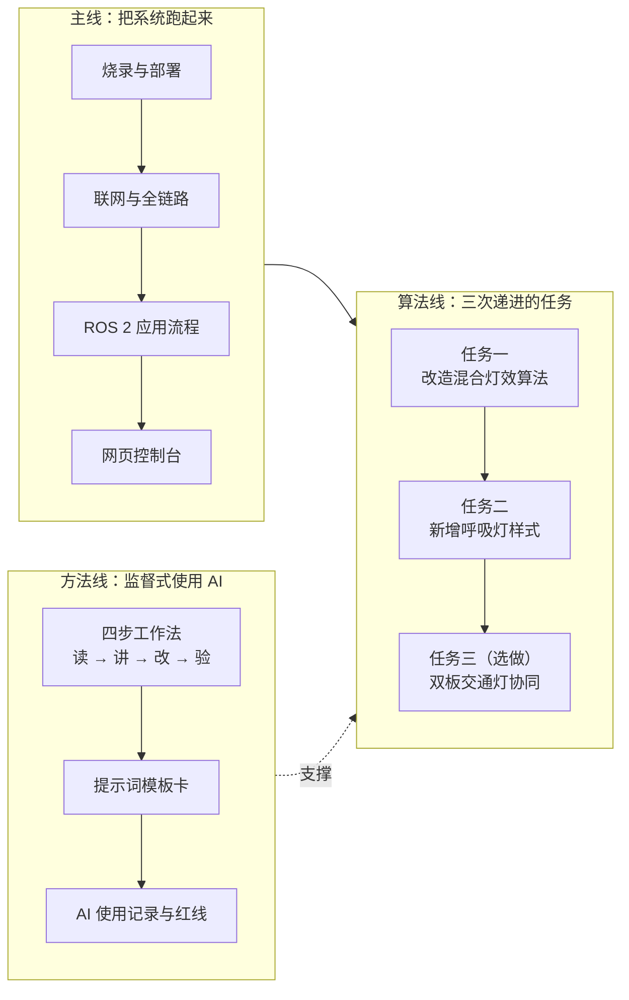

# 《ESP32 与 ROS 2 开发基础》短平快课程方案

> **1 天集中教学 + 3–4 天自学实践（合计约 30 学时）｜面向职业本科**
>
> 学生用书：[07-学生学习手册.md](07-学生学习手册.md)——学习目标、知识讲解、动手步骤、
> 验收清单与记录表全在手册里，学生按手册逐单元完成即可；本方案供教师与教学管理使用。
>
> 课程要解决两件事：
> **① 学生能独立走通「设备 → 网络 → ROS 2 → 应用」整条链路**，建立 ROS 2 应用开发流程的完整认知；
> **② 学生学会在教师监督下使用 AI 工具**，完成本项目的算法改造任务——能解释、能验证、有记录。

## 一、课程基本信息

| 项目 | 内容 |
|---|---|
| 课程名称 | ESP32 与 ROS 2 开发基础（短平快版） |
| 课程性质 | 专业实践课（集中教学 + 自主实践 + 结课验收） |
| 适用对象 | 职业本科电子信息、物联网、机器人、智能制造、计算机等专业，已学 Python 基础语法 |
| 建议学时 | 约 30 学时：第 1 天集中教学 8 学时 + 自学实践 20 学时 + 结课验收 2 学时（按 3–4 天弹性安排，加练可再延 6 学时） |
| 建议学分 | 1 学分（按各校学分折算办法调整） |
| 先修知识 | 计算机应用基础；能读简单代码、会改参数（不要求独立编写完整程序） |
| 教学场地 | 机房 / 实训室：Windows 电脑（两人一组）、WSL2 + ROS 2 环境、2.4 GHz 无线局域网 |
| 每组设备 | ESP32-S3 开发板 2 块（绿板 / 蓝板）+ 数据 USB 线 2 根 + 独立热点或小路由器 1 套 |
| 结课成果 | 一条能现场演示的完整链路 + 至少两个算法改造（混合灯效算法改造、新增呼吸灯样式）+ 一份 AI 使用记录 |

## 二、课程定位与设计思路

本课程是 48 学时版《ESP32 与 ROS 2 开发基础》的**强化短版**，面向小学期、实训周、
竞赛集训前的快速入门，以及师资培训。课程不追求芯片底层与协议内部原理，把 48 学时
压缩成"**最小完整链路 + 算法改造**"：

四条设计原则：

1. **能上手**：删除从零编程与版本管理操作，点灯编程压缩为"读懂 + 改参数"；难度集中在"读真实工程代码"上；
2. **看得见**：每个环节先看现象（灯亮、消息通、页面动），再讲原理；
3. **学到方法**：把"在监督下使用 AI 工具"作为正式教学内容，学生产出可检查、可追问的 AI 使用记录；
4. **做得出**：三次算法任务都落在真实工程代码上，改完当场能演示、能对照、能解释。

## 三、学习目标

### （一）知识目标

1. 说出系统数据链路的五个环节（开发板 → 无线网络 → 转发器 → ROS 2 桥接 → 网页界面）及每个环节里的数据形态；
2. 说明行协议与心跳机制的作用，解释 `/board/板名/tx`（发给板子）与 `/board/板名/rx`（板子回报）两个话题的方向；
3. 描述 ROS 2 应用开发流程：源码在工作空间 → 构建 → 启动 → 节点通过话题通信 → 应用界面；
4. 解释混合灯效的合成算法（按时间采样、亮灭取"或"、颜色通道相加截断）与呼吸灯的时间函数思想；
5. 说明"监督式使用 AI"的三条约束（先要清单、最小改动、给依据）与验证方法。

### （二）能力目标

1. 独立完成固件烧录、程序部署、联网、启动全栈，并会查日志定位常见故障；
2. 会用命令行与网页控制灯效：改色、保存与应用样式、轮播、混合、恢复默认；
3. 能读懂 `composite()` 等算法函数并完成改造：改前写预测、改后做对照、验后做回归；
4. 能按"修改点清单 → 最小改动 → 逐条验证"的流程新增一种灯效模式（呼吸灯）；
5. （挑战）能设计并按单一路线实现双板协同逻辑（交通灯），连续演示不掉链子；
6. 全程使用 AI 工具时做到：每一行都能解释、每条建议有验证、按模板留 AI 使用记录。

### （三）素质目标

1. **安全与保密**：遵守外接电源与防静电规范；WiFi 密码不投屏、不截图、不进 AI 对话；
2. **工程严谨**：先复现、再定位、后求助；改动前留底、改动后验证，形成可复用的排障思路；
3. **协作沟通**：结对操作与互查，能把"我改了什么、为什么"讲给同伴听；
4. **学术诚信**：能解释自己提交的每一行代码（包括 AI 生成的）；不编造实验记录与 AI 日志。

## 四、课程内容与学时分配

| 学习单元 | 主要内容 | 集中学时 | 自学学时 | 对应任务与考核 |
|---|---|---|---|---|
| 单元一 让系统跑起来 | 烧录固件、一键部署、联网、启动全栈，看到两块板上线 | 4 | 4 | 全链路复现证据包 |
| 单元二 看清数据怎么流动 | ROS 2 应用流程、话题与指令体系、网页控制台、断线重连 | 3 | 4 | 数据流图 + 教师抽查问答 |
| 单元三 改造混合灯效算法 | 读懂合成函数；"加权平均 / 逐通道取最大"二选一改造 | 1（教师示范起步） | 6 | 任务一：观感对照 + 回归清单 |
| 单元四 新增呼吸灯样式 | 协议字段扩展 + 三角波亮度函数 + 显示分支 | — | 6 | 任务二：验收断言全过 |
| 单元五（选做）双板交通灯协同 | 两板状态互补的协同逻辑（板端或 ROS 2 侧实现） | — | 4–6 | 任务三：连续 60 秒演示 |
| 结课验收 | 现场演示 + 答辩 + AI 记录核查 | — | 2 | 终验评分 |
| **合计** | | **8** | **22–26** | |

> 单元三在第 1 天下午由教师做"示范性起步"（约 1 学时），学生在自学第 2 天完整重做。

## 五、教学实施

### （一）第 1 天：集中教学安排（8 学时）

| 时段（示例） | 环节 | 内容 | 学生做到 |
|---|---|---|---|
| 08:30–09:10 | 环节一 开场与全景 | 教师演示完整系统（命令行改色、页面轮播与混合、双板心跳互见）；画链路大图；讲清课程两条目标、每天要交什么；安全与保密要求 | 能复述链路五环节与本课程目标 |
| 09:10–10:30 | 环节二 烧录与部署 | 探测芯片 → 擦写固件 → 进 REPL → 一键部署两块板（命令卡每桌一张） | 两块板按绿 / 蓝闪烁，串口出现板名标识 |
| 10:45–12:00 | 环节三 联网与全链路 | 填网络配置 → 重新部署 → 启动转发器 → 构建并启动 ROS 2 全栈 → 两块板注册上线；故意重启服务器观察自动重连 | 串口看到 `link up`、服务器日志看到两块板注册、亲眼看一次断线重连 |
| 13:30–14:45 | 环节四 ROS 2 应用流程 | 命令行改色与复位；网页控制台六项操作（保存、应用、轮播、混合、恢复默认、在线状态）；讲清"构建 → 启动 → 话题 → 桥接 → 界面"流程 | 命令行改色成功；页面操作全过；能说清发送与回报的方向 |
| 15:00–16:05 | 环节五 AI 上手与代码走读 | 用手册的「数据链路梳理」「指令全路径」两张提示词模板让 AI 画出完整调用链；打开源码逐条核对，记录 AI 说得不准的地方 | 提交一条"AI 回答核对记录"，含至少一处不准确或含糊之处 |
| 16:05–16:40 | 环节六 任务发布与示范 | 教师现场做一次最小改造示范（把轮播"每个样式 4 个周期"改成 2 个，重新部署看变化）；发布自学安排、三个任务与 AI 使用要求 | 能说出四步工作法与三条红线；知道每天做什么、交什么 |

教师操作用补充要点：

- 各环节的完整命令与常见报错处理，对照学生手册（单元一、二）与 [03-实验指导书.md](03-实验指导书.md) 的实验一、四、六、七、八、十一；
- 提速措施：工具预装、命令卡片放每桌、卡壳超过 10 分钟先换备用板（备用板提前烧好、部署好）；
- 环节三的故障注入是本课程"故障驱动教学"的入口，先让学生猜、再验证、最后讲原理。

### （二）自学阶段安排（3 天 + 弹性加练）

| 时间 | 主题 | 学生完成 | 教师抽查 |
|---|---|---|---|
| 自学第 1 天 | 独立复现与流程固化 | 不看课堂记录，按手册单元一、二从头复现全链路，每一步留证据；完成"改端口验证重建"与"断线重连观察"两个小实验；手绘数据流图 | 证据包是否完整；口头抽查：发送与回报的方向、改代码后为什么要重新构建 |
| 自学第 2 天 | 任务一：改造混合灯效算法 | 按手册单元三：先预测、再改、后对照；完成回归检查与学习记录 | 改动是否只落在指定函数；预测与实测的差异能否解释；AI 使用日志 |
| 自学第 3 天 | 任务二：新增呼吸灯样式 | 按手册单元四：先写修改点清单，再最小改动，逐条通过验收断言 | 断言是否全过；能否解释亮度公式中每个符号的含义 |
| 弹性加练日（可选） | 任务三：双板交通灯协同（或补做任务一 / 二） | 完成挑战任务或返工重做；整理结课演示材料 | 技术路线是否单一、协议是否自洽；拔板行为是否有明确定义 |

- **3 天制压缩**：取消弹性加练日；任务三转为选做；结课验收放在自学第 3 天最后 2 小时（演示简化为每组 3 分钟）。
- **进度快的班级**：自学第 2 天上午完成任务一后直接进入任务二；满足条件的可提前挑战任务三。
- **进度慢的班级**：任务二的验收放宽为"常亮 / 闪烁 / 呼吸三种模式切换正确"，亮度函数使用教师提供的三行参考实现。

### （三）教学策略

1. **现象先行**：每个环节的第一次演示一定是"能看、能玩"的结果，原理放在现象之后；单次连续讲授不超过 15 分钟；
2. **结对实操**：两人一组轮换"操作者 / 记录者"，每 20–30 分钟交换角色；
3. **故障驱动**：教师有意制造安全的小故障（停服务器、拔网线、写错端口），学生按"物理 → 网络 → 端口 → 应用"分层法定位；
4. **AI 监督带教**：所有 AI 使用都在四步工作法（读 → 讲 → 改 → 验）框架内进行；教师抽查"理解"而不是抽查"结果"——问"这行为什么这么写"，不问"功能通了吗"。

### （四）教师课前准备清单

**提前一周**

- [ ] 学生机镜像：Windows 10/11 + Python 3.10+（安装 `esptool`、`mpremote`、`pyserial`）；WSL2 Ubuntu 24.04 + ROS 2 Jazzy（可预生成构建产物 `ros2_ws/install`）；
- [ ] 教师机完整预演一遍全流程：烧录 → 部署 → 转发器 → 构建 → 启动 → 话题 → 页面；
- [ ] 准备 2.4 GHz 独立热点 / 小路由器（关闭 AP 隔离）；记录热点与教师机（Windows）局域网 IP；
- [ ] 确定 AI 工具（见手册 §三），确认教室网络可访问；准备断网预案（见下表）；
- [ ] 备用板 1–2 块：提前烧好固件并部署好对应板程序，课上用于快速换板；备用 USB 数据线。

**当天早上（5 分钟）**

- [ ] 两块板插好、串口识别、未被其他串口工具占用；转发器与 ROS 2 全栈先在教师机跑一遍；
- [ ] 每组下发：2 块板 + 2 条数据线 + 命令卡；`wifi_config.py` 现场分发填写（含密码，不投屏、不截图）。

### （五）应急预案

| 情况 | 处理 |
|---|---|
| 改为 3 天制 | 见"自学阶段安排"的压缩说明；任务三转选做 |
| 学员基础普遍偏弱 | 任务一给"修改点清单"半成品；任务二使用参考实现 |
| 设备故障 | 先换线再换板；备用板 5 分钟替换；故障板课后处理 |
| 教室网络不稳 | 全部环节可在本机完成；WiFi 用手机热点兜底；`SERVER_IP` 变化后重新部署（过程本身即教学素材） |
| AI 服务不可用 | 启用"示例对话卡"：教师提前打印 3 段典型提示词与参考回答，学生练习判读与核对；改动由教师机演示；密钥红线不变 |

## 六、考核与评价

### （一）成绩构成（100 分）

| 考核项 | 分值 | 评分说明 |
|---|---|---|
| 自学第 1 天：全链路证据包 | 15 | 每个环节有截图或日志；教师抽查问题 1–3 答对 |
| 自学第 2 天：任务一 | 15 | 改动正确且只落在指定函数；预测与实测对照完整；回归检查通过 |
| 自学第 3 天：任务二 | 15 | 验收断言全过；能解释亮度公式与三个修改点的作用 |
| AI 使用纪律与记录 | 15 | 记录完整（含至少 1 条被推翻的 AI 建议）；无密钥泄露；提示词按模板使用 |
| 结课演示 | 20 | 脱稿复现全链路；算法改造现场生效（改前改后对照） |
| 结课答辩 | 20 | 教师随机抽 3 个问题；能解释自己改动的每一行 |

### （二）教师随机抽查问题库（结课答辩抽 3 个）

1. 从网页点击"应用"到板子变色，中间经过哪些程序、文件和话题？
2. 为什么板子要主动连出来，而不是电脑连板子？
3. `DATA` 心跳的作用是什么？网页多久判离线？断线后多久自动恢复？
4. `STYLE SET` 与 `STYLE USE` 有什么区别？为什么"保存"不改当前灯效？
5. 混合灯效的合成规则原来是什么？你改成了什么？观感为什么变了？
6. 呼吸灯的亮度公式是什么？周期和样式周期是什么关系？
7. 你让 AI 做了什么？它哪条建议你最终没有采纳？为什么？
8. 改板端代码后为什么要重新部署？改 ROS 2 代码后为什么要重新构建？
9. 两块板用同一个名字注册会发生什么？
10. 如果去掉 relay 节点，两块板之间还能互相看到心跳吗？

### （三）红线（触及任一条，对应考核项记 0 分）

1. WiFi 密码写进 AI 对话、截图或提交物；
2. 无法解释自己提交的代码（含 AI 生成部分）；
3. 实验记录、AI 日志编造。

## 七、与 48 学时课程的关系

| 处理 | 内容 |
|---|---|
| **保留（最小闭环）** | 固件烧录与一键部署；WiFi 联网与转发器；ROS 2 工作空间 / 话题 / 启动；样式指令体系（保存 / 应用 / 轮播 / 混合）；网页控制台 |
| **压缩** | 点灯编程 → 读懂 `main.py` 并改颜色参数；串口心跳 → 在日志里观察；样式增删改查全细节 → 保留核心操作；故障案例 → 只讲"板子没有 Python"与"服务器重启后自动重连"两个 |
| **删除** | 版本管理操作教学；固件镜像内部结构（只留"完整镜像必须烧 0x00"一句）；从零编写 MicroPython 程序；纸质实验记录规范 |
| **新增（本课程核心）** | AI 四步工作法（读 → 讲 → 改 → 验）；提示词模板卡；三个递进算法任务；AI 使用记录与监督红线；每日抽查点 |

与原 11 个实验的对应关系：

| 原实验 | 短平快课程去处 | 处理 |
|---|---|---|
| 一 环境搭建与固件烧录 | 第 1 天 环节二 | 压缩：工具预装，只做探测、擦写与 REPL 验证 |
| 二 点亮板载 RGB | 第 1 天 环节二 | 压缩：不写从零，改入口文件颜色参数观察 |
| 三 自定义闪烁编程 | — | 删除（快班可作选做） |
| 四 工程化与一键部署 | 第 1 天 环节二 | 保留核心 |
| 五 串口心跳与协议 | 第 1 天 环节三 | 合并进联网段（在日志里观察心跳） |
| 六 WiFi 联网与 TCP | 第 1 天 环节三 | 保留（最小测试服务器步骤改为教师演示） |
| 七 排障与转发器 | 第 1 天 环节三 + 自学第 1 天 | 保留 + 故障注入练习 |
| 八 工作空间与话题 | 第 1 天 环节四 + 自学第 1 天 | 升格为流程核心 |
| 九 桥接节点解析与 LED 控制 | 第 1 天 环节五 + 自学第 2 天 | 保留（走读 + 指令实操） |
| 十 样式管理、轮播与混合 | 自学第 2、3 天 + 任务一、二 | 保留并升级为算法开发 |
| 十一 Web 控制台 | 第 1 天 环节四 | 保留（页面六项操作 + 在线状态） |

> 原实验的完整步骤与常见问题见 [03-实验指导书.md](03-实验指导书.md)。

## 八、教学条件与资源

- 学生用书：[07-学生学习手册.md](07-学生学习手册.md)（含 AI 辅助开发方法与三个算法任务）
- 参考材料：[03-实验指导书.md](03-实验指导书.md)（完整实验步骤）、[05-教师手册.md](05-教师手册.md)（真实故障案例库）
- 工程代码：`教学demo/ESP32-ROS2-LED协同系统/`（`common/`、`green/`、`blue/`、`tools/`、`ros2_ws/` 与两块板固件）
- 技术要点文字版：`docs/ESP32与ROS2开发基础.md`；讲义 deck：`教学webppt/ESP32与ROS2开发基础/`
- 一键下载（课程包 + 代码 + 固件 zip）：`教学webppt/ESP32与ROS2开发基础/files/ESP32与ROS2课程包与代码.zip`
