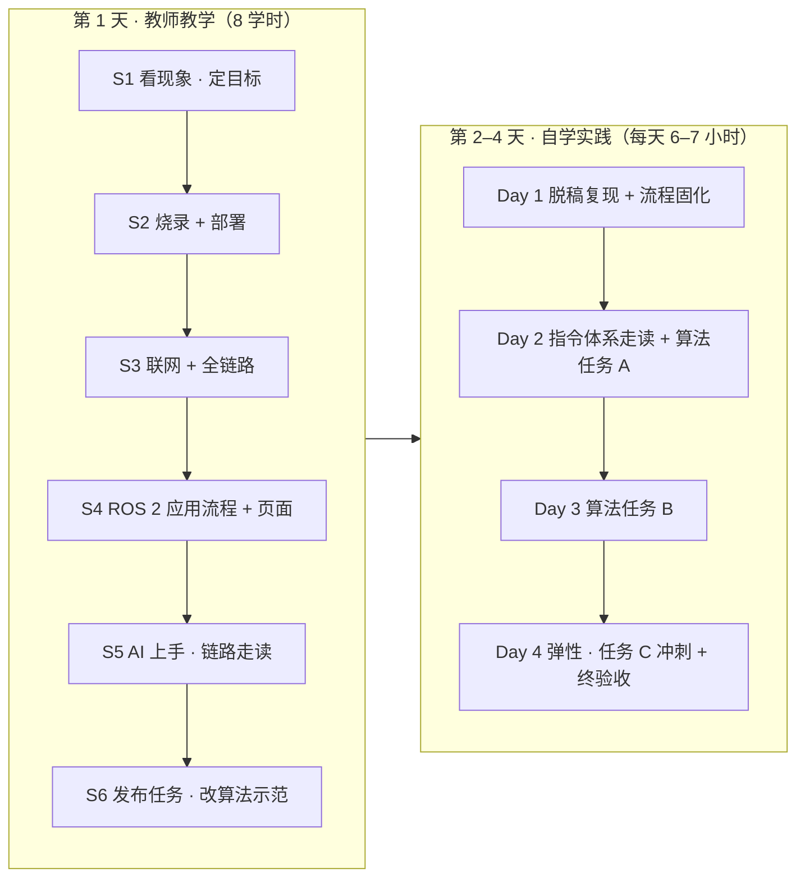

# 《ESP32 与 ROS 2 开发基础》短平快集训方案

> 1 天教师教学 + 3–4 天自学实践｜面向职业本科｜两条硬目标：
> **① 理解 ROS 2 应用流程**（构建 → 启动 → 话题 → 桥接 → 界面，能独立复现全链路）；
> **② 在教师监督下用 AI 工具完成本项目的算法开发**（能解释、能验证、有记录）。

## 一、定位与目标

### （一）适用场景

- 职业本科电子信息 / 物联网 / 机器人 / 智能制造 / 计算机等专业，具备基础 Python（能读代码、改参数）；
- 小学期、实训周、竞赛集训前的快速入门、师资培训；
- 目标不是"上完一门课"，而是**用最短时间把「设备 → 网络 → ROS 2 → 应用」整条链走通，并学会用 AI 工具在监督下改算法**。

### （二）两条硬目标（验收口径）

| 目标 | 验收口径（做到才算过） |
|---|---|
| ROS 2 应用流程理解 | 脱稿从零复现全链路：烧录 → 部署 → 联网 → `colcon build` → `ros2 launch` → 话题收发 → 页面操作；能画出数据流图并说出每一环的进程、文件与话题名 |
| AI 监督下的算法开发 | 完成至少 1 张算法任务卡（见 [07-AI监督开发工作流.md](07-AI监督开发工作流.md) §七），提交 AI 使用日志；改动代码**每一行都能解释**，每条 AI 建议都经过手工验证，并有至少 1 条"被推翻的 AI 建议"记录 |

### （三）明确不做（给 48 学时版留空间）

- 不写从零 Python 程序（改为"读懂 + 改参数 + 改函数"）；
- 不展开固件内部结构、DDS 内部机制、git 工作流；
- 不做闭卷笔试，全部当堂/当次验收。

## 二、总体设计：与 48 学时版的关系



### （一）保留 / 压缩 / 新增

| 处理 | 内容 |
|---|---|
| **保留（最小闭环）** | 固件烧录与一键部署；WiFi 联网与转发器；ROS 2 工作空间 / 话题 / launch；样式指令体系（SET/USE/LIST、PLAY、MIX）；Web 控制台 |
| **压缩** | 点灯编程 → 读懂 `main.py` 并改颜色参数；串口心跳 → 在日志里观察 5 分钟；样式 CRUD 全细节 → 保留核心三条；故障案例 → 只讲 2 个（"板子没有 Python"与"服务器重启后重连"） |
| **删除** | git 操作教学；固件镜像内部结构（只留一句"完整镜像必须烧 0x0"）；从零编写 MicroPython 程序；实验记录纸质规范 |
| **新增（本次改造核心）** | AI 四步工作法（读 → 讲 → 改 → 验）；算法任务卡 A/B/C；AI 使用日志与监督红线；每日检查点 |

### （二）与原 11 个实验的映射

| 原实验 | 短平快去处 | 处理 |
|---|---|---|
| 一 环境搭建与固件烧录 | 第 1 天 S2 | 压缩：工具预装，只做探测 + 擦写 + REPL 验证 |
| 二 点亮板载 RGB | 第 1 天 S2 | 压缩：不写从零，改 `main.py` 颜色参数观察 |
| 三 自定义闪烁编程 | — | 删除（快班可作选做） |
| 四 工程化与一键部署 | 第 1 天 S2 | 保留核心 |
| 五 串口心跳与协议 | 第 1 天 S3 | 合并进联网段（日志观察 `DATA` 心跳） |
| 六 WiFi 联网与 TCP | 第 1 天 S3 | 保留（`mini_server` 步骤改为教师演示） |
| 七 排障与转发器 | 第 1 天 S3 + 自学 Day 1 | 保留 + 故障注入练习 |
| 八 工作空间与话题 | 第 1 天 S4 + 自学 Day 1 下午 | 升格为流程核心 |
| 九 桥接节点解析与 LED 控制 | 第 1 天 S5 + 自学 Day 2 上午 | 保留（走读 + 指令实操） |
| 十 样式管理、轮播与混合 | 自学 Day 2/3 + 任务卡 A/B | 保留并升级为算法开发 |
| 十一 Web 控制台 | 第 1 天 S4 | 保留（页面六项操作 + 在线状态） |

> 原实验的完整步骤、命令与常见问题见 [03-实验指导书.md](03-实验指导书.md)，本方案只做取舍与节奏安排。

## 三、教师课前准备

**提前一周**

- [ ] 学生机镜像：Windows 10/11 + Python 3.10+；`python -m pip install esptool mpremote pyserial`；WSL2 Ubuntu 24.04 + ROS 2 Jazzy；
- [ ] 教师机完整预演一遍：烧录 → 部署 → 转发器 → `colcon build` → `ros2 launch` → 话题 → 页面（构建产物 `ros2_ws/install` 可预生成，现场少等）；
- [ ] 2.4 GHz 独立热点/小路由（关 AP 隔离）；记录 SSID/密码与**教师机（Windows）局域网 IP**；
- [ ] 确定 AI 工具（见 [07-AI监督开发工作流.md](07-AI监督开发工作流.md) §二），确认教室网络可访问；准备断网预案（§八）；
- [ ] 备用板 1–2 块（**提前烧好 MicroPython 并部署好对应板程序**，课上用于快速换板）；备用 USB 数据线。

**当天早上（5 分钟清单）**

- [ ] 两块板插好、CH343 端口识别、未被 Thonny/串口助手占用；
- [ ] 转发器与 `ros2 launch` 可正常工作（先在教师机跑一遍）；
- [ ] 每组下发：2 块板 + 2 条数据线 + 打印好的"命令卡"（§四 S2/S3/S4 的命令摘出，每桌一张）；
- [ ] `common/wifi_config.py` 在**现场**分发填写（含密码，不投屏、不截图、不提前放进共享目录）。

## 四、第 1 天：教师教学日程（8 学时 ≈ 365 分钟含间休）

| 时段（示例） | 环节 | 内容 | 学生产出 / 验收点 |
|---|---|---|---|
| 08:30–09:10 | S1 开场 | 教师演示完整系统（命令行改色、页面轮播/混合、双板心跳互见）；画链路大图；讲目标与安全红线 | 能复述"板 → WiFi → 转发器 → WSL ROS 2 → 页面"链路与当天目标 |
| 09:10–10:30 | S2 实操：烧录 + 部署 | 探测 `flash-id` → 擦写固件 → REPL 验证 → `deploy.py` 双板部署；板载灯闪烁 + 串口标识 | ⭐ `flash-id` 输出 + 两板正常闪烁（绿/蓝）+ 能解释 `0x0` 偏移 |
| 10:30–10:45 | 间休 | | |
| 10:45–12:00 | S3 实操：联网 + 全链路 | 填 `wifi_config.py` → 重新部署 → Windows 转发器 → WSL `colcon build` + `ros2 launch` → 两板 `registered` → 故障注入：杀服务器看 12 s 重连 | ⭐ `link up` + 转发器日志 + `wifi_server` 两板注册 + 亲眼看一次断线重连 |
| 12:00–13:30 | 午休 | | |
| 13:30–14:45 | S4 实操：ROS 2 应用流程 | `ros2 topic list/echo/pub` 改色与 RESET；`led_ui` 页面六项操作（保存→应用→轮播→混合→恢复默认→在线状态实验）；讲"构建 → 启动 → 话题 → 桥接 → 界面"流程骨架（不展开 DDS） | ⭐ 命令行改色成功；⭐ 页面六项操作全过；⭐ 能说出 `tx`/`rx` 方向 |
| 14:45–15:00 | 间休 | | |
| 15:00–16:05 | S5 AI 上手 + 链路走读 | 安装/登录教师指定的 AI 工具；用提示词模板 T1/T2（见 07 §四）让 AI 画"页面点击 → 板子变色"调用链；**对照源码逐条核对**，记录 AI 说错/含糊的地方 | ⭐ 提交 1 条"AI 回答与源码核对结果"（含至少 1 处差异或不精确） |
| 16:05–16:40 | S6 发布任务 + 示范 | 教师用 AI 现场演示一次小改造（`PLAY_PERIODS` 4 → 2，轮播切换加快，重新部署对比观感）；发布 3 天计划、任务卡与检查点；答疑 | 能说出四步工作法与红线；领走任务卡与日志模板 |

### 各环节要点

**S2（90 分钟，两人一组）**

- 命令卡（详细步骤见 [03-实验指导书.md](03-实验指导书.md) 实验一、四）：

```powershell
python -m esptool --port COM13 --baud 460800 flash-id
python -m esptool --port COM13 --baud 460800 erase-flash
python -m esptool --port COM13 --baud 460800 write-flash -z 0x0 "教学demo/ESP32-ROS2-LED协同系统/firmware/GENERIC_S3-20220618-v1.19.1.bin"
python tools\deploy.py COM13 green
python tools\deploy.py COM14 blue
```

- 提速要点：`flash-id` 只做一块板；`mpremote` 首次 raw REPL 失败**等 2 秒重试**（不是故障）；串口被占用先关再试；卡住超过 10 分钟直接换备用板，故障板课后处理。

**S3（75 分钟）**

- `SERVER_IP` 填**教师机（Windows）**的局域网 IP，不是 WSL 的地址；热点必须 2.4 GHz；
- 断线重连现象（杀 `wifi_server` → 板子每 4 秒重试 → 约 12 秒恢复）安排为"先猜再验"的小悬念。

**S4（75 分钟）**

- 流程骨架按"应用开发者视角"讲：源码在工作空间 `src/` → `colcon build` 产出 `install/` → `launch` 一次起 3 个节点 → 话题是节点间唯一接口 → 页面就是一个普通话题客户端；
- 页面操作时强调两条设计规则：`STYLE SET` 只保存不切换（保存与应用分离）、`default` 不可删除。

**S5（65 分钟）**

- 这是"监督下的 AI"第一课：**AI 先讲，人再核对**。学生必须打开源码找到 AI 说的关键位置（例如 `wifi_server.py` 的 `make_tx_callback`、`board_common.py` 的 `apply`/`composite`），核对方法与记录模板见 [07-AI监督开发工作流.md](07-AI监督开发工作流.md)。

**S6（35 分钟）**

- 示范改造点：`common/board_common.py` 的 `PLAY_PERIODS = 4` 改为 `2` → 重新 `deploy.py` → `PLAY red blue` 观察切换加快——"改一行、验一轮"的最小闭环；
- 发布自学三天日程（§五）、任务卡 A/B/C 与 AI 日志模板，明确每日检查点的提交方式与时间。

## 五、第 2–4 天：自学实践日程

每天固定节奏：**上午动手复现 / 走读 → 下午开发与验证 → 收尾提交证据包 + AI 日志**。教师每天设 1–2 个"监督点"（§七），学生按任务卡推进。

### Day 1 · 脱稿复现与流程固化

| 时段 | 任务 |
|---|---|
| 上午（约 3 h） | **脱稿复现全链路**（不允许翻课堂笔记，允许查 [03-实验指导书.md](03-实验指导书.md)）：探测 → 烧录 → 部署 → 联网 → 转发器 → launch → 话题 → 页面。每步留证据（截图/日志），凑成"全链路证据包" |
| 下午（约 3.5 h） | **P1 流程闭环**：改 `wifi.launch.py` 的环境变量 `UI_PORT`（如 8081）→ 重新 build/启动 → 验证端口变化 → 改回；<br>**P2 故障注入**：杀 `wifi_server` 计时重连；拔一块板看页面 10 秒判离线；<br>**P3 话题实验**：`ros2 topic pub -r 1` 连发 vs `--once`；用 `echo` 抓一次 `STYLE LIST` 的多行回复逐字段读；<br>**P4 手绘数据流图**：页面 → `/tx` → TCP → 板 → `/rx` → 页面 |
| AI 环节 | 让 AI 解释 P1–P3 的每条命令与每个文件角色（模板 T1/T2）；整理 **3 条"经自己验证的 AI 回答"** + 1 条"AI 说不清/说错" |
| 检查点 | 证据包完整；能回答抽查问题 1–3（见 §六问题库）；`UI_PORT` 修改生效证明 |

### Day 2 · 指令体系走读 + 算法任务 A

| 时段 | 任务 |
|---|---|
| 上午（约 3 h） | **指令体系实操**：`STYLE SET` 三条样式（红快闪/蓝常亮/黄慢闪）→ `STYLE USE` / `DEL` / `LIST` → `default` 保护验证（`STYLE-ERR protected`）→ `PLAY` / `MIX` 各演示一次；<br>**代码走读**：对照源码填表——`apply()` 分发、`_style()` 增删查、`composite()` 合成、`relay` 的 `FROM` 转发；串口观察板间 `[RX] FROM ...` |
| 下午（约 3.5 h） | **算法任务卡 A（MIX 合成规则改造）**：完整走 AI 四步工作法（读 → 讲 → 改 → 验），改前改后各录 10 秒观感，与事前预期对照；做回归检查（`MIX STOP`、错样式报错、其他指令不受影响） |
| AI 环节 | 全程使用四步工作法；日志必须含 **1 条被推翻的 AI 建议**；只允许小步改动，禁止整文件重写 |
| 检查点 | 任务 A 的 diff + 观感对照记录 + AI 日志（教师抽查 diff 与解释） |

### Day 3 · 算法任务 B（呼吸样式）

| 时段 | 任务 |
|---|---|
| 上午（约 3 h） | **算法任务卡 B（新增 `breathe` 呼吸样式）**：协议字段扩展（`solid/blink/breathe`）+ 时间函数（三角波亮度）+ 主循环显示分支；先在纸上写出亮度函数与验收断言，再动代码 |
| 下午（约 3 h） | 联调与回归：`STYLE LIST` 回包、`MIX` 中含 `breathe` 的叠加语义、`RESET`/旧样式不回归；整理终验材料（演示脚本、原理问答准备） |
| AI 环节 | 让 AI 先只给"修改点清单"（允许说'先不改'）；人工审定后再逐个落地；每个落地小步都要有验证证据 |
| 检查点 | 任务 B 验收断言全过 + 回归清单 + AI 日志；能解释亮度公式里每个参数 |

### Day 4（弹性日）· 挑战与终验收

| 时段 | 任务 |
|---|---|
| 上午（约 3 h） | **算法任务卡 C（双板交通灯协同）** 冲刺，或补做 B / 自拟任务 D（教师审核）；教师巡场，重点看"技术路线是否单一、协议是否自洽" |
| 下午（约 3 h） | **终验收**：每组 5 分钟演示（全链路复现 + 算法改造效果改前改后对照）+ 3 个原理问答 + AI 日志与"被推翻建议"抽查；总结与延伸路径 |
| 检查点 | 终验评分表（§六）；AI 使用记录归档 |

> **3 天制压缩**：取消弹性日；任务 C 转为选做；终验收并入 Day 3 下午最后 2 小时（演示简化为 3 分钟/组）。
> **进度快的学生**：Day 2 上午用 1 小时完成 A 后直接进入 B；Day 3 开始 C；Day 4 可做任务 D 自拟。

## 六、短版考核（100 分制）

| 考核项 | 分值 | 形式 |
|---|---|---|
| Day 1 全链路证据包 | 15 | 提交证据（每步截图/日志）+ 抽查问题 1–3 |
| Day 2 任务 A + AI 日志 | 15 | diff 审查 + 观感对照记录 + 日志完整（含被推翻建议） |
| Day 3 任务 B 验收 | 15 | 验收断言全过 + 回归清单 + 解释代码 |
| AI 使用纪律与记录质量 | 15 | 密钥红线、提示词模板使用、验证习惯（全程累计） |
| 终期演示 | 20 | 全链路脱稿复现 + 算法改造现场生效（改前改后对照） |
| 终期答辩与解释 | 20 | 3 个原理问题 + 抽查解释改动代码每一行 + AI 日志对照 |

**红线（触及任一条，对应项记 0 分）**：

1. WiFi 密码写进 AI 对话、截图或提交物；
2. 无法解释自己提交的代码（含 AI 生成部分）；
3. 实验记录、AI 日志编造。

**终答辩抽查问题库（教师随机抽 3 个）**：

1. 从页面点"应用"到板子变色，中间经过哪些进程/文件/话题？
2. 为什么板子要主动连出来（客户端），而不是电脑连板子？
3. `DATA` 心跳的作用是什么？页面多久判离线？断线后多久自动恢复？
4. `STYLE SET` 与 `STYLE USE` 的区别？为什么"保存"不切换？
5. `MIX` 的合成规则是什么？你改成了什么？观感为什么变了？
6. `breathe` 的亮度公式是什么？周期和 `period` 字段什么关系？
7. 你让 AI 做了什么？哪条建议你最终没有采纳？为什么？
8. 改板端代码后为什么要重新 `deploy`？改 ROS 2 代码后为什么要 `colcon build`？
9. 两块板同名注册会发生什么？
10. 如果去掉 `relay`，两板之间还能互相看到心跳吗？

## 七、教师监督机制（AI 使用）

详见 [07-AI监督开发工作流.md](07-AI监督开发工作流.md)，本方案中的监督动作按天收敛为：

| 时间 | 监督动作 |
|---|---|
| 第 1 天 S5 | 检查"AI 回答核对记录"：必须有至少 1 处与源码不符/含糊的发现 |
| 自学 Day 1 晚 | 线上收证据包；抽查问题 1–3（语音/视频 2 分钟） |
| 自学 Day 2 晚 | 审查任务 A 的 diff（重点：是否只改了该改的函数）+ AI 日志 |
| 自学 Day 3 晚 | 验收任务 B 断言；抽查"被推翻的 AI 建议"属实性 |
| Day 4 终验 | 演示 + 问答 + 日志对照；教师保留抽问"这一行为什么这么写"的权力 |

## 八、伸缩与应急预案

| 情况 | 处理 |
|---|---|
| 3 天制 | 见 §五末尾"3 天制压缩"；任务 C 选做 |
| 学员普遍偏快 | A 卡压缩到 1 小时热身；B/C 提前；增加任务 D（自拟，须教师审核） |
| 学员普遍偏慢 | 任务 B 验收放宽到"blink 与 breathe 切换正确即可"，亮度函数用教师给的三行模板 |
| 设备故障 | 先换线再换板；备用板已预烧预部署，5 分钟替换 |
| 教室网络不稳 | 转发器/launch/构建全部在本机可完成；WiFi 用手机热点兜底；`SERVER_IP` 变化后重新部署（此过程本身是教学素材） |
| AI 服务不可用 | 启用"示例对话卡"：教师提前打印 3 段典型提示词与参考回答，学生练习判读与核对（只练"讲/验"，改动由教师机演示）；密钥红线不变 |

## 九、资源清单

- 完整实验步骤与故障排查：[03-实验指导书.md](03-实验指导书.md)、[05-教师手册.md](05-教师手册.md)
- AI 工作流、提示词模板与算法任务卡：[07-AI监督开发工作流.md](07-AI监督开发工作流.md)
- 工程代码：`教学demo/ESP32-ROS2-LED协同系统/`（`common/`、`green/`、`blue/`、`tools/`、`ros2_ws/` 与两块板固件）
- 技术要点文字版：`docs/ESP32与ROS2开发基础.md`；讲义 deck：`教学webppt/ESP32与ROS2开发基础/`
- 一键下载（课程包 + 代码 + 固件 zip）：`教学webppt/ESP32与ROS2开发基础/files/ESP32与ROS2课程包与代码.zip`
