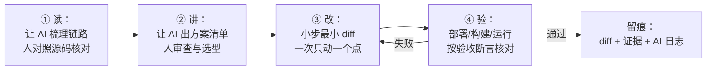

# AI 监督开发工作流（学生手册 + 教师监督点）

> 配套 [06-短平快集训方案.md](06-短平快集训方案.md) 使用。
> 一句话原则：**AI 先讲，人再核对；AI 生成，人必须能解释；每条建议都要有验证证据。**

## 一、为什么要"有监督"：AI 在这门课里的能与不能

| AI 擅长（放心用） | AI 容易翻车（必须盯） |
|---|---|
| 综述代码：把一堆文件梳理成调用链 | **幻觉引用**：编造不存在的函数名、行号、文件 |
| 逐行解释：把 `composite()` 讲成新手能懂的话 | **过度重构**：把 `blink()` 主循环改成阻塞式，心跳停摆 |
| 方案对比：给出 2–3 种改法及影响清单 | **破坏兼容**：悄悄改掉 `default` 保护、协议字段含义 |
| 写小改动：给定约束下的最小 diff | **想当然**：不了解 20ms tick、心跳 4s 等运行约束就下笔 |
| 生成测试用例、整理记录 | **过度自信**：错了也很流畅，不验证就会被带沟里 |

监督的含义不是"少用 AI"，而是：**限定范围（只改哪、不许动哪）、强行验证（跑起来、看日志）、留痕（日志 + 被推翻的建议）**。

## 二、工具与准备

| 档位 | 方案 | 说明 |
|---|---|---|
| 理想 | VS Code + AI 编程助手（本仓库原生是 Kilo；同类还有 Claude Code、通义灵码、Trae 等） | 能读仓库文件、能执行命令、改动有 diff 可查——**首选** |
| 可用 | 编辑器 + 网页对话（把相关代码片段复制给 AI，输出手动应用） | 无插件环境；注意只贴相关片段，不贴密钥 |
| 兜底 | 教师打印的"示例对话卡"（3 段提示词 + 参考回答） | 教室断网/服务不可用时：只练"讲"与"验" |

- 用哪个工具由**教师现场指定**；同一小组用同一种，便于互查。
- 提前确认账号可用、网络可达；把工具装在**做实验的那台电脑**上。
- `common/wifi_config.py`（含真实 WiFi 密码）**不喂给任何 AI**；需要讨论时用 `SSID=***` 代替。

## 三、四步工作法：读 → 讲 → 改 → 验



| 步骤 | 学生做什么 | 证据 | 教师监督点 |
|---|---|---|---|
| ① 读 | 用 T1/T2/T3 类提示词让 AI 给出"文件:函数"调用链 | AI 回答 + 自己核对结果（标出不符处） | 第 1 天 S5：每人至少报 1 处 AI 不准确/含糊 |
| ② 讲 | 用 T4/T6 类提示词要求 AI **只给修改点清单，先不改代码** | 清单 + 人工选型理由（为什么选 A 不选 B） | Day 2 上午：抽查方案是否踩了运行约束 |
| ③ 改 | 用 T5 类提示词要求**最小 diff**；改动前复制原文件留底 | diff（对照原件） | Day 2 晚：只允许动了"任务卡圈定"的位置 |
| ④ 验 | 部署/构建/运行；对照任务卡"验收断言"逐条打勾 | 日志、截图、观感记录（改前/改后） | Day 3 晚：断言全过才算完成；抽查解释每一行 |

**提高成功率的三句话（写进每条提示词）**：

1. "**先不要改代码**，只列出修改点清单和影响面。"
2. "**只修改 XX 函数内部**，不要动函数签名、不要动其他文件、不要重构。"
3. "**每条给出依据**：引用本仓库具体的文件与函数，不确定的地方明确标注。"

## 四、提示词模板库（T1–T10）

> 直接复制、改括号部分即可。每条模板后标注了"你必须做的验证"。

**T1 链路综述（读）**

> 在这个项目里，以"网页控制台点击某样式的『应用』按钮，绿板变色"为例，列出从前端到板端的完整调用链：每步给出 `文件路径:函数名`，并说明该步的数据形态（HTTP 参数 / ROS 2 话题消息 / TCP 行文本 / 像素值）。只给结论清单，不要贴大段代码。

验证：打开 `led_ui.py`、`wifi_server.py`、`board_common.py` 找到 AI 说的关键函数（如 `make_tx_callback`、`apply`），核对是否存在、方向对不对。

**T2 指令全路径（读）**

> `COLOR 255 0 0` 这条指令从 `ros2 topic pub` 发出后，到绿板 WS2812 亮起红色，经过哪些进程与函数？按执行顺序列出，并指出每一步最可能失败的位置。

验证：对照 `wifi_server.py`（订阅 `/board/green/tx` → `sendall`）与 `board_common.py`（`Link.lines()` → `state.apply()` → `blink()` 主循环 `_pixels`）。

**T3 逐行解释（读）**

> 用新手能懂的语言解释 `common/board_common.py` 中 `StyleSet.composite()` 的每一行，重点是 `lit` 的计算和 `min(255, r)` 的作用。

验证：给同学讲一遍，讲不通就说明没读懂。

**T4 方案对比（讲）**

> 我要把 `composite()` 的合成规则从"亮灭 OR + 颜色相加截断"改成"加权平均"或"逐通道取最大"。请分别给出：①两种规则对"红 120ms 快闪 + 蓝常亮"混合观感的预测；②每种方案的最小修改点清单（不要给完整新函数）。

验证：先把观感预测写进实验记录，改完对照——**预测错了是好事，说明你真的观测了**。

**T5 最小改动（改）**

> 按"加权平均"方案，只修改 `composite()` 函数体内部，给出最小 diff：不要动函数签名、不要动其他函数、不要重构。注意所有样式都不亮的时段不能除零。

验证：对照 diff 逐行解释；确认没有动清单之外的地方。

**T6 新增样式类型（讲 → 改）**

> 我想给板端增加 `breathe`（呼吸）样式（`STYLE SET name R G B period breathe`）。请先列出需要修改的函数清单和每处的最小改法（先不要给完整代码），并指出它对 `MIX` 合成带来的兼容性问题。

验证：核对是否覆盖了 `_pattern_value()`、`blink()` 显示分支、`composite()` 三处；漏了就让 AI 补。

**T7 排障（验）**

> 现象：板子串口显示 `link up`，但 `wifi_server` 没有 `green registered` 日志。按可能性排序给出原因清单，每条附一个验证命令或观察点。

验证：逐条实测（先查 `SERVER_IP` 是不是教师机的 Windows IP，再查转发器是否在运行）。

**T8 自查挑错（验）**

> 以下是我按你建议改出的 diff（粘贴）。请对照本项目主循环的约束（每 20ms tick、非阻塞、心跳每 4s 必发、按键与链路读取不能停），找出这段改动可能破坏原行为的地方。

验证：AI 指出的问题逐条确认；它没发现但让你怀疑的地方，用"跑 60 秒看页面在线状态"来复核。

**T9 写测试（验）**

> 为 `composite()` 写 3 个边界用例的预期输出：①`mixlist` 为空；②所有样式都不在亮相位；③多个样式通道相加超过 255。用 Python 断言形式写，不要引用仓库其他模块。

验证：在 REPL 里手工构造对应状态试运行，断言与实测一致。

**T10 整理记录（留痕）**

> 把今天的改动整理成实验记录：现象（改前观感）→ 假设（预期观感）→ 改动点（函数与行为）→ 验证结果（是否与预期一致）→ 结论。不要编造我没有提供的数据，缺失处用【待补】标注。

验证：通读一遍，删掉任何"AI 帮你编的"内容。

## 五、红线与纪律

1. **密钥不上传**：`wifi_config.py` 内容、SSID/密码、真实 IP 默认不进 AI 对话（讨论用 `***` 代替）；
2. **核心运行代码只打补丁不重构**：`blink()` 主循环、`Link`、`wifi_server`、`led_ui` 的改动必须是最小 diff；改动前复制原文件留底；
3. **解释不了就回退**：每一行 AI 代码都要能说出"为什么这么写"；说不清就撤销重做；
4. **一切 AI 结论都要手工验证**：跑一遍、看日志、对照源码——三选一不算数，至少"跑 + 看"；
5. **日志留档**：按模板记录；全程至少留下 **1 条被推翻的 AI 建议**（这是加分项，不是减分项）；
6. 工具以教师指定为准；不把与课程无关的个人信息、账号信息发给 AI。

## 六、AI 使用记录模板

| # | 任务 | 提示词要点 | AI 建议摘要 | 采纳 / 推翻 | 验证方式与证据 |
|---|---|---|---|---|---|
| 1 | 链路走读 | T1 | （摘要，1–2 行） | 采纳 | 对照 `wifi_server.py:44`…，AI 把行号说错，实际在… |
| 2 | 任务 A 方案 | T4 | … | 推翻 | 预测"平均后更亮"，实测更暗，原因：… |
| … | | | | | |

提交要求：至少覆盖本阶段全部提示词使用；"推翻"栏至少 1 条并写明推翻理由。

## 七、算法任务卡（A/B/C/D）

> 所有任务卡通用规则：只改圈定的位置；改动前后各留证据（观感/日志）；验收断言逐条打勾；AI 使用按四步工作法。
> 代码位置以 `教学demo/ESP32-ROS2-LED协同系统/` 为准。

### 任务卡 A · MIX 合成规则改造（★★，Day 2 下午）

**目标**：把 `StyleSet.composite()`（`common/board_common.py`）的合成规则从"亮灭 OR + 颜色相加截断"改为二选一：

- 方案① **加权平均**：当前亮着的样式颜色取平均（各占 1/n，n 为亮着的样式数）；
- 方案② **逐通道取最大**：r/g/b 分别取所有亮着样式的最大值。

**现状关键行为**：`lit = (t // period) % 2 == 0` 决定每条样式此刻亮不亮；亮着的颜色通道直接相加；`min(255, ·)` 做截断饱和（防止超过 255）。

**验收断言**：

- [ ] 红 `(255,0,0)` 120ms 快闪 + 蓝 `(0,0,255)` 常亮：改前混合为紫（相加截断），改后符合所选规则的预测观感（平均偏暗 / 取最大不饱和）；观感与"事前写下的预测"对照并记录差异；
- [ ] 所有样式都不亮的时段输出 `(0,0,0)`，无除零崩溃；
- [ ] 回归：`MIX STOP`、错误样式名报 `STYLE-ERR`、单一样式 `MIX` 行为不变；
- [ ] 能解释两种规则各自的缺点（如平均会整体拖暗、取最大丢失"叠加变亮"的直觉）。

**AI 使用建议**：提示词 T4 → T5 → T9；先让 AI 预测观感再动手，预测与实测的差异要记录（这就是"验证"的价值）。

**审查点**：diff 是否只落在 `composite()` 函数体内部；是否顺手改了 `mixlist` 语义或调用方。

### 任务卡 B · 新增 `breathe` 呼吸样式（★★★，Day 3）

**目标**：给板端增加第三种样式类型 `breathe`：亮度随时间平滑"渐亮 → 渐灭"，一个完整呼吸周期等于样式的 `period` 字段。

**涉及位置（先自己找齐，再用 AI 核对）**：

- `_pattern_value()`：目前只有 `solid/on/steady → solid`，其余全归 `blink`，需要识别 `breathe`；
- `blink()` 主循环显示分支：`solid → 常亮 / blink → 每 period 翻转`，需要新增 breathe 分支（每 20ms tick 更新一次亮度）；
- `composite()`：`breathe` 样式在 `MIX` 里的语义由你定义（推荐：视为始终"亮"，颜色按当前亮度缩放），定义与表现必须一致；
- `STYLE LIST` 回包无需改动（直接打印 pattern 字符串），但要用它验证。

**亮度函数（参考，可自选，但报告里要写明并解释）**：

```python
def _tri(t_ms, period_ms):
    phase = (t_ms % period_ms) / period_ms   # 0..1
    return 1.0 - abs(2.0 * phase - 1.0)      # 0 → 1 → 0
```

**验收断言**：

- [ ] `STYLE SET bre 0 100 0 1200 breathe` 后肉眼可见平稳呼吸，约 1.2 秒一轮；
- [ ] `STYLE LIST` 中 `bre` 的 pattern 显示为 `breathe`；
- [ ] `RESET` 回默认正常；`STYLE USE bre` 再切回呼吸；
- [ ] `MIX bre`（可加第二条样式）表现与你自己写下的合成语义一致；
- [ ] 呼吸运行 60 秒期间页面在线状态不闪断（证明主循环没有被阻塞）。

**审查点（AI 最容易翻车）**：

- 用 `while True` + `time.sleep_ms()` 写阻塞式呼吸 → 心跳停、链路断（页面判离线）；
- 把 `_pattern_value` 的未知值行为改成报错 → 破坏向后兼容；
- 每次循环无条件写像素、或改了 `TICK_MS`/主循环结构；
- 亮度乘法没有转回整数（`_pixels` 需要 int 通道）。

### 任务卡 C · 双板交通灯协同（★★★☆，Day 4 弹性日 / 挑战）

**目标**：两块板模拟十字路口两个方向：绿板"绿"时蓝板"红"，按固定时长（如 5 秒）交替，两侧状态始终互补。

**路线一（板端实现）**：`relay` 已把对板心跳转发为 `FROM <板名> <seq>` 行。板端在 `blink()` 主循环里统计收到的 `FROM` 行数，达到阈值切换本板样式。
局限：节拍受 4 秒心跳粒度限制（1 条=4s、2 条=8s），配时精度低——报告里要写明这个取舍。

**路线二（ROS 2 侧，推荐挑战组）**：新写一个调度节点（如 `traffic.py`），用定时器每 N 秒向 `/board/green/tx` 与 `/board/blue/tx` 交替发布 `STYLE USE` 指令；板端零改动。需要：写节点 → 加 `setup.py` 入口 →（可选）加进 `wifi.launch.py` → `colcon build` → 运行观察。
好处：完整练一遍"ROS 2 应用流程"——写节点、构建、启动、话题观察。

**验收断言**：

- [ ] 连续运行 60 秒：两板一"行"一"停"交替，周期与设定一致；
- [ ] 演示中拔掉/重连一块板，另一块板的行为有明确定义（继续循环或保持安全态，报告里写明并现场验证）；
- [ ] 能画数据流图，并解释为什么走 ROS 2 中转（而不是两块板直连）。

**选路线建议**：时间紧、想练板端协议解析 → 路线一；想练 ROS 2 应用流程（本集训重点）→ 路线二。

### 任务卡 D · 自拟（教师审核）

模板：①目标与用户场景（一句话）；②涉及文件与函数（自己先找，再用 AI 核对）；③验收断言（至少 3 条可判定）；④AI 使用计划（哪些提示词模板）；⑤风险与回退方案。
参考题：`led_ui` 显示"最后心跳时间"；给 `MIX` 加相位参数；`PLAY` 改为按时间而非周期数切换。

## 八、教师监督点速查

| 时间 | 抽查什么 | 参考问题 |
|---|---|---|
| 第 1 天 S5 | AI 核对记录 | "你让 AI 画链路，它哪里说得不准？你用什么核对的？" |
| 自学 Day 1 | 证据包 + 流程问答 | 问题库 1–3（见 06 §六） |
| 自学 Day 2 | 任务 A diff + AI 日志 | "平均方案你预测会更亮还是更暗？实测呢？""你推翻了 AI 哪条建议？" |
| 自学 Day 3 | 任务 B 断言 + 解释 | "呼吸的亮度公式里每个符号是什么？""为什么不能在显示分支里 sleep？" |
| Day 4 终验 | 演示 + 日志对照 + 追问 | "这一行为什么这么写？""如果把 TICK_MS 改成 200ms 会怎样？" |
