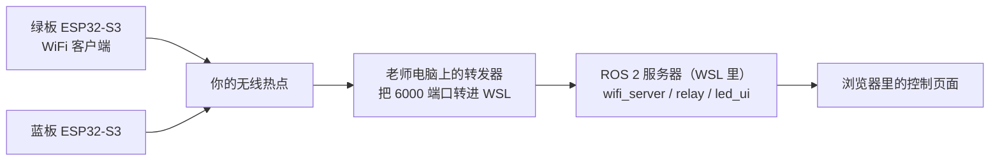

# 《ESP32 与 ROS 2 开发基础》短平快课程 · 学生学习手册

> 这是你在这门课里的**学习与操作手册**。每个单元都按同样的结构展开：
> 【学习目标】→【知识加油站】→【动手做】→【验收清单】→【学习记录】→【自测题】。
> 配套教师用《[06-短平快课程方案.md](06-短平快课程方案.md)》。
> 手册没写全的故障处理，可查 [03-实验指导书.md](03-实验指导书.md) 与 [05-教师手册.md](05-教师手册.md)。

## 一、课程地图：这门课你要完成什么

学完后你要交出三样东西：

1. **一条能现场演示的完整链路**：两块开发板经无线网络接入电脑里的 ROS 2，用网页控制灯效；
2. **两个算法改造**：任务一"改造混合灯效算法"、任务二"新增呼吸灯样式"（任务三"双板交通灯"为挑战项）；
3. **一份 AI 使用记录**：证明你在监督下规范地使用了 AI 工具（模板见 §3.5）。


- **第 1 天（集中教学）**：教师带你把单元一、二走一遍，并示范单元三的起步；
- **自学第 1 天**：不看课堂记录，自己把单元一、二完整重做一遍；
- **自学第 2 天**：完成单元三（任务一）；
- **自学第 3 天**：完成单元四（任务二）；
- **弹性加练日（可选）**：单元五（任务三）或返工补做，然后结课验收。

## 二、使用说明：先花五分钟读这里

### （一）标记说明（本手册里所有标记的含义）

| 你看到的标记 | 它的含义 |
|---|---|
| 【学习目标】 | 本单元结束时"你能做到什么"，用"我能……"的句子写 |
| 【知识加油站】 | 动手前要懂的原理，用大白话讲；看不懂可以先跳过，做完再看一遍 |
| 【动手做】 | 一步步的操作：**做什么 → 输入什么命令 → 你会看到什么 → 不对怎么办** |
| 【验收清单】 | 做完逐条打勾的清单；全部打勾才算完成任务 |
| 【学习记录】 | 需要你填写的表格或要求，它就是你的作业与证据 |
| 【自测题】 | 检查自己是不是真的懂了；参考答案在附录 D |
| 提示 | 小字经验，能帮你少踩坑 |
| 任务一 / 任务二 / 任务三 | 三个算法任务的正式名称，手册与课堂上都用这个名字称呼 |

### （二）命令怎么读

- 写 `COM13`、`COM14` 时，你要换成**自己电脑上**识别到的口号（在"设备管理器"里找 CH343，或运行 `python -m mpremote devs`）；
- 命令里路径含中文时要加引号，例如 `write-flash -z 0x0 "...固件.bin"`；
- 写法 `python -m esptool ...` 表示在 **Windows 的 PowerShell** 里输入；
- 写法 `ros2 ...`、`colcon ...` 表示在 **WSL（Ubuntu）终端**里输入，且要先运行过一次 `source` 命令（见单元一）。

### （三）安全与三条纪律（每次动手前默读一遍）

1. 板子只用 USB 供电；不要用外部电源直接接引脚；插拔前先摸一下金属把静电放掉；练习亮度不要开太亮（不超过 100 级别）；
2. 上课的网络是独立热点，不要把路由器接进校园网；
3. **WiFi 密码（`wifi_config.py` 里的内容）不进任何 AI 对话、不截图、不提交**。

## 三、AI 辅助开发基础（先学方法，再动手）

这门课允许、而且要求你使用 AI 工具，但必须**规范地**用：AI 先讲，你核对；AI 生成，你解释；
每条 AI 建议都要有验证证据。后面每个单元都会用到本章的方法。

### 3.1 AI 能帮你做什么、不能替你做什么

| AI 擅长（放心用） | AI 靠不住（必须盯） |
|---|---|
| 把一堆文件梳理成调用链 | 编造不存在的函数名、行号、文件 |
| 用新手能懂的话逐行解释代码 | 不看运行约束就"顺手重构"，把心跳循环改坏 |
| 给出 2–3 种改法及影响清单 | 悄悄改掉协议字段含义、破坏兼容 |
| 在限定范围内写出最小改动 | 说得很流畅，但结果是错的 |
| 生成测试用例、整理记录草稿 | 随口编数据、编结论 |

### 3.2 四步工作法：读 → 讲 → 改 → 验

| 步骤 | 你做什么 | 留下什么证据 |
|---|---|---|
| ① 读 | 让 AI 讲链路、讲函数；**你打开源码逐条核对** | AI 回答 + 你标出的不准确处 |
| ② 讲 | 让 AI 只给"修改点清单"，**先不改代码**；你选方案、写理由 | 清单 + 你的选择理由 |
| ③ 改 | 要求"最小改动"，一次只动一个点；改前把原文件复制一份留底 | 改动前后的对比（原件 / diff） |
| ④ 验 | 部署、运行、观察、对照验收清单；记录"预测 vs 实测" | 日志、截图、观感对照 |

### 3.3 写提示词时的三句话约束

把下面三句话加进你每一次的关键提问里：

1. "**先不要改代码**，只列出修改点清单和影响面。"
2. "**只修改 XX 函数内部**，不要动函数签名、不要动其他文件、不要重构。"
3. "**每条给出依据**：引用具体的文件与函数；不确定的地方明确标注。"

### 3.4 提示词模板卡（十个场景，按需取用）

> 用法：把"【】"里的内容替换成你的实际情况，直接发给 AI。
> 每张卡最后一行是"你要核对什么"——这一步不能省。

**模板一 · 数据链路梳理（读）**

> 在【教学demo/ESP32-ROS2-LED协同系统】这个项目里，以"网页控制台点击某样式的『应用』按钮，绿板变色"为例，列出从前端到板端的完整调用链：每一步给出"文件:函数名"，并说明这一步的数据形态（网页请求 / ROS 2 话题消息 / 网络文本行 / 灯光颜色值）。只给清单，不要贴大段代码。

你要核对：打开 `led_ui.py`、`wifi_server.py`、`board_common.py`，找到 AI 说的关键函数（如 `make_tx_callback`、`apply`），看看是否真的存在、方向对不对。

**模板二 · 指令全路径（读）**

> `COLOR 255 0 0` 这条指令从 `ros2 topic pub` 发出后，到绿板的灯变成红色，中间经过哪些程序与函数？按执行顺序列出，并指出每一步最可能失败的位置。

你要核对：`wifi_server.py` 里订阅话题后把内容写回板子的函数、`board_common.py` 里读回数据并执行指令的函数。

**模板三 · 逐行解释（读）**

> 用新手能懂的话解释 `common/board_common.py` 里 `StyleSet.composite()` 的每一行，重点是 `lit` 这行怎么算、`min(255, r)` 有什么用。

你要核对：给同学讲一遍，讲不通就是没读懂。

**模板四 · 方案对比（讲）**

> 我要把 `composite()` 的合成规则从"亮灭取或 + 颜色相加截断"改成"加权平均"或"逐通道取最大"。请分别给出：①两种规则对"红快闪 + 黄常亮"混合观感的预测；②每种方案的最小修改点清单（不要给完整新函数）。

你要核对：先把观感预测写进学习记录，改完实测对照——预测错了是好事，说明你真的观察了。

**模板五 · 最小改动（改）**

> 按"加权平均"方案，只修改 `composite()` 函数体内部，给出最小改动（diff）：不要动函数名和参数、不要动其他函数、不要重构。注意所有样式都不亮的时段不能除以零。

你要核对：对照改动逐行解释；确认没有动清单以外的地方。

**模板六 · 新增样式清单（讲）**

> 我想给板子增加 `breathe`（呼吸）模式：`STYLE SET 名字 R G B 周期 breathe`。请先列出需要修改的函数清单和每处的最小改法（先不要给完整代码），并指出它对混合功能带来什么影响。

你要核对：是否覆盖了"模式识别、显示分支、混合语义"三处；漏了就让 AI 补。

**模板七 · 排障排序（验）**

> 现象：板子串口显示 `link up`，但服务器没有 `green registered` 日志。按可能性排序给出原因清单，每条附一个验证办法。

你要核对：逐条实测（先查配置里的服务器地址是不是教师电脑的 IP，再查转发器是否在运行）。

**模板八 · 自查挑错（验）**

> 以下是我按你建议改出的代码（粘贴你的改动）。请对照本项目主循环的要求（每 20 毫秒一轮、不阻塞、心跳每 4 秒必发、按键与网络读取不能停），找出这段改动可能破坏原行为的地方。

你要核对：AI 指出的问题逐条确认；跑 60 秒看网页在线状态是否闪断。

**模板九 · 写测试用例（验）**

> 为 `composite()` 写 3 个边界用例的预期输出：①没有任何样式在混合；②所有样式都不在"亮相"时刻；③多个样式的颜色相加超过 255。用 Python 断言的形式写，不要引用其他模块。

你要核对：在板子 REPL 或电脑上手工试一遍，断言与实测一致才算过。

**模板十 · 整理记录（留痕）**

> 把今天的改动整理成实验记录：现象（改前看到什么）→ 预测（预计变成什么）→ 改动（改了哪几行、为什么）→ 验证结果（与预测是否一致）→ 结论。不要编造我没有提供的数据，缺失的地方用【待补】标注。

你要核对：通读一遍，删掉任何 AI 帮你"编"的内容。

### 3.5 红线与 AI 使用记录

**三条红线（违反则对应考核项记 0 分）**：

1. WiFi 密码进 AI 对话、截图或提交物；
2. 解释不了自己提交的代码（包括 AI 生成的部分）；
3. 编造实验记录与 AI 日志。

**AI 使用记录表**（每次使用 AI 后填一行；"被推翻的建议"至少要有 1 条，这是加分项）：

| 第几次 | 任务 | 用了哪张模板 | AI 建议摘要 | 采纳 / 推翻 | 验证方式与结果 |
|---|---|---|---|---|---|
| 1 | 链路走读 | 模板一 | … | 采纳 | 对照源码发现 AI 把行号说错了，实际在… |
| 2 | 任务一方案 | 模板四 | … | 推翻 | 预测"平均更亮"，实测更暗，因为… |
| … | | | | | |

## 四、学习单元

### 单元一 让系统跑起来

**【学习目标】** 我能：① 找到串口并给开发板烧录固件；② 用一键部署脚本把程序装到两块板上；③ 让两块板连上网络并注册到 ROS 2 服务器。

**【知识加油站 1】开发板、固件和 MicroPython**

- 开发板出厂时装的是一段"演示程序"，里面没有 Python。我们要给它**烧录**一份带 Python 解释器的固件（叫 MicroPython），之后板子就能直接运行 Python 程序。
- ESP32-S3 的**完整固件镜像**要从地址 `0x0` 开始烧；烧录工具叫 `esptool`，本机用法固定为 `python -m esptool`（这样调用最稳）。
- 烧完复位后，板子会自动运行设备里的 `main.py`——那就是"这台设备上跑的程序"。

**【动手做 1-1】探测与烧录（约 30 分钟）**

1. 安装工具（每台电脑一次，管理员可以预装好）：

   ```powershell
   python -m pip install esptool mpremote pyserial
   ```

2. 插上板子，列出串口：

   ```powershell
   python -m mpremote devs
   ```

   **你会看到**：类似 `COM13 ... CH343` 的条目；里面的口号就是后面命令要用的。
   **不对怎么办**：列表为空 → 换一根**数据线**（不是充电线）、确认设备管理器里有没有 "CH343"。

3. 探测芯片信息：

   ```powershell
   python -m esptool --port COM13 --baud 460800 flash-id
   ```

   **你会看到**：`ESP32-S3`、`16MB` Flash、芯片 MAC 地址。
   **不对怎么办**：`could not open port` → 关闭 Thonny / 串口助手等占用端口的程序再试。

4. 擦除，然后烧写固件（两行都不许省；路径含中文要加引号）：

   ```powershell
   python -m esptool --port COM13 --baud 460800 erase-flash
   python -m esptool --port COM13 --baud 460800 write-flash -z 0x0 "教学demo/ESP32-ROS2-LED协同系统/firmware/GENERIC_S3-20220618-v1.19.1.bin"
   ```

   **你会看到**：两行进度条，末尾都是 `Hash of data verified.`。
   **不对怎么办**：超时或连接失败 → 确认端口号、换数据线；老话一句：报错先读报错。

5. 进入交互环境（REPL）验证：

   ```powershell
   python -m mpremote connect COM13
   ```

   在 `>>>` 后面输入 `print("hello esp32")`，按回车。
   **你会看到**：屏幕打印 `hello esp32`；按 `Ctrl-]` 退出。
   **不对怎么办**：报 `could not enter raw repl` → 等 2 秒重试一次（这是常见现象，不是板子坏了）。

**【知识加油站 2】一键部署脚本做了什么**

部署 = **把程序文件上传到板子，再让它重新运行**。`tools/deploy.py` 会依次上传：
`board_common.py`（公共程序：灯效、联网、指令解析）、`wifi_config.py`（网络配置）、
`main.py`（这块板的入口：颜色 + 板名），最后**单独复位**一次。
（经验：上传和复位必须在两次连接里分开做，否则板子会停在交互模式不运行程序——脚本已经处理好了。）

**【动手做 1-2】配置网络并部署两块板（约 20 分钟）**

1. 复制网络配置模板：

   ```powershell
   copy common\wifi_config.example.py common\wifi_config.py
   ```

2. 用记事本打开 `common/wifi_config.py`，填入老师给你的：热点名称、密码（必须 2.4 GHz 的热点）、
   服务器地址（填**教师电脑的局域网 IP**，不是 WSL 的地址）。**此文件不截图、不投屏。**

3. 部署两块板（先插一块，再插另一块；端口号以实际为准）：

   ```powershell
   python tools\deploy.py COM13 green
   python tools\deploy.py COM14 blue
   ```

   **你会看到**：绿板开始绿色闪烁，蓝板开始蓝色闪烁；串口打印 `[GREEN]`、`[BLUE]` 标识。
   **不对怎么办**：`ImportError` → 公共文件没传上去，重跑部署；灯不亮 → 检查是不是部署到了另一块板。

**【知识加油站 3】整条链路长什么样**



- 板子会**主动连出去**，连上后先说一句 `HELLO 板名`（注册），之后每 4 秒说一句
  `DATA 板名 序号`（这叫**心跳**，用来证明"我还在线"）。
- "转发器"存在的理由：WSL 虚拟机默认拒绝来自局域网的连接，用一个小程序把
  电脑的 6000 端口转发到 WSL 的 6001 端口，问题就绕开了。

**【动手做 1-3】启动整条链路（约 25 分钟）**

1. 在 **Windows** 启动转发器（开着别关）：

   ```powershell
   python tools\tcp_forwarder.py --listen 0.0.0.0:6000 --target 127.0.0.1:6001
   ```

2. 在 **WSL 终端**构建并启动 ROS 2 全栈：

   ```bash
   source /opt/ros/jazzy/setup.bash
   cd "到工程目录的 ros2_ws 文件夹"
   colcon build
   source install/setup.bash
   UI_HOST=0.0.0.0 ros2 launch board_bridge wifi.launch.py
   ```

   **你会看到**：日志里先出现 `listening on 0.0.0.0:6001`，随后出现 `green registered`、`blue registered`。
   **不对怎么办**：先看板子串口有没有 `link up`；有 `link up` 但服务器没日志 → 检查转发器窗口是否在跑。

3. 故意实验（故障驱动）：按 `Ctrl-C` 关掉第 2 步的服务器，等 10 秒再启动。
   **你会看到**：板子每 4 秒重试一次，约 12 秒内自动恢复注册——不需要你复位板子。

**【验收清单】**

- [ ] `flash-id` 能看到型号、容量截图
- [ ] 两块板按绿 / 蓝闪烁，串口有板名标识
- [ ] 转发器窗口有连接日志
- [ ] ROS 2 日志出现两块板 `registered`
- [ ] 亲眼看一次"服务器重启 → 板子自动重连（约 12 秒）"，记在下面的记录表里

**【学习记录】**

| 步骤 | 我的命令 | 看到的现象 | 遇到的问题与解决 |
|---|---|---|---|
| 探测 | | | |
| 烧录 | | | |
| 部署绿板 / 蓝板 | | | |
| 启动链路 | | | |
| 重连实验 | | | |

**【自测题】**

1. 为什么固件必须烧到 `0x0`，而不是别的地址？
2. `HELLO` 与 `DATA` 分别是什么时候发出的？起什么作用？
3. 板子断线后大约多久自动重连？靠什么机制做到的？

### 单元二 看清数据怎么流动

**【学习目标】** 我能：① 说出 ROS 2 应用开发的五步流程；② 用命令行和网页控制灯效；③ 画出"从点击到变色"的完整数据流。

**【知识加油站 1】ROS 2 应用流程（只从"用"的角度看）**

1. **源码**放在工作空间的 `src/` 里（本项目是一个功能包 `board_bridge`，里面有
   `wifi_server`、`relay`、`led_ui` 三个**节点**——三个各自干活的小程序）；
2. **构建**：运行 `colcon build`，把源码"安装"到 `install/`；
3. **生效**：运行 `source install/setup.bash`，终端才知道去哪里找这个包；
4. **启动**：一条 `ros2 launch` 同时启动三个节点；
5. **通信与应用**：节点之间靠**话题**传消息；网页控制台就是一个"会说话的界面"。

- **话题**像广播频道：谁订阅谁收到。每个板子有两个话题：
  `/board/green/tx`（**发给板子**）、`/board/green/rx`（**板子回报**）。
  `tx` 和 `rx` 都是从"服务器"的视角命名的，别记反。

**【知识加油站 2】一行一条的"行协议"与心跳**

- 所有指令都是普通文本行，例如 `STYLE USE red`、`MIX red blue`、`RESET`；
  为什么用文本：看得懂、能手工发、出错容易查。
- 板子回报里常见两类：`DATA 板名 序号`（心跳）与 `STYLE-OK / STYLE-ERR ...`（指令应答）。
- 网页凭心跳判断在线：**超过 10 秒**没收到心跳就显示"离线"。

**【动手做 2-1】用命令行控制板子（约 25 分钟）**

1. 列出话题：

   ```bash
   ros2 topic list
   ```

   **你会看到**：`/board/green/rx`、`/board/green/tx`、`/board/blue/...`、`/board/xrs/...` 等。

2. 观察板子回报（先开这个终端，让它一直滚动）：

   ```bash
   ros2 topic echo /board/green/rx
   ```

   **你会看到**：每约 4 秒一行 `data: DATA GREEN 3`、`4`、`5`……（序号在增加）。

3. 发一条改色指令（注意引号与消息格式，另一终端执行）：

   ```bash
   ros2 topic pub --once /board/green/tx std_msgs/String "{data: 'COLOR 255 0 0'}"
   ```

   **你会看到**：绿板变成红色；板子串口打印 `[RX GREEN] COLOR 255 0 0`。

4. 再试两条：`PERIOD 200`（闪烁加快）、`RESET`（恢复默认闪烁）。

   **不对怎么办**：`ros2: command not found` → 忘 `source` 了，回到单元一第 2 步重做；
   板子没反应 → 看服务器日志有没有 `offline, dropping`（说明板子掉线了）。

**【动手做 2-2】网页控制台六项操作（约 25 分钟）**

在浏览器打开 `http://<WSL 的 IP>:8080`（在 WSL 里运行 `hostname -I` 可查 IP），完成六件事：

- [ ] 看两块板的在线状态徽标；
- [ ] 新建一条样式（如 `show 255 100 0 300 blink`）→ 点**保存样式** → 确认当前灯效没变；
- [ ] 点这条样式的**应用** → 灯切换；
- [ ] 勾选 2–3 条 → **轮播所选** → 停止轮播；
- [ ] 勾选 2 条 → **混合所选** → 停止混合，观察合成颜色；
- [ ] 点**恢复默认** → 回到原始绿 / 蓝闪烁。

**【动手做 2-3】两个"固化认知"小实验（约 30 分钟）**

1. **改端口验证构建**：把启动文件 `ros2_ws/src/board_bridge/launch/wifi.launch.py`
   里的界面端口默认值 8080 改成 8081 → 重新 `colcon build` → 重启 → 页面换到 8081。
   体会："改代码 → 必须重新构建才生效"。
2. **断线重连观察**（如果单元一已做过，可以跳过）。

**【AI 环节】** 用"模板一（数据链路梳理）"和"模板二（指令全路径）"让 AI 画出完整调用链；
打开源码逐条核对，把 AI 说得不准的地方记到学习记录里。

**【验收清单】**

- [ ] 命令行成功改色，并成功 `RESET`
- [ ] 页面六项操作全部完成
- [ ] 改端口实验成功（证明重建才生效）
- [ ] AI 回答核对记录 1 条（含至少一处不准确或含糊）

**【学习记录】** 手绘"点击 → 变色"数据流图并拍照贴入；填写 AI 核对记录。

**【自测题】**

1. 从网页点"应用"到板子变色，中间经过哪些程序？(提示：页面 → 服务器 → 网络 → 板子)
2. 为什么"保存样式"不切换当前灯效？这个设计为谁考虑？
3. 网页凭什么判断一块板在线 / 离线？

### 单元三 任务一：改造混合灯效算法

**【学习目标】** 我能：① 解释混合灯效合成函数的每一行；② 完成"加权平均"或"逐通道取最大"的改造；③ 用"预测 → 实测 → 对照"的方法验证算法改动。

**【知识加油站 1】样式与"混合"到底是什么**

- 一条**样式** = 颜色（红绿蓝三个数值）+ 周期（毫秒）+ 模式（常亮 / 闪烁）。
- 一块板同一时刻只能显示一种颜色。所谓"混合"，是每隔 20 毫秒把多条样式的
  "此刻状态"合成出一种颜色再显示——快到眼睛以为是同时播放。
- 现在的合成规则（在 `common/board_common.py` 的 `composite()` 函数里）：
  **亮不亮 → 取"或"；颜色 → 三个通道分别相加，超过 255 就按 255 算（截断）。**

**【知识加油站 2】逐行读懂合成函数**

```python
def composite(self, now):
    t = time.ticks_diff(now, self.mix_t0)   # 从开始混合到现在，过了多少毫秒
    r = g = b = 0                            # 三个颜色通道的累加器
    for name in self.mixlist:                # 挨个看正在混合的样式
        style = self.styles.get(name)
        if style is None:                    # 样式被删了就跳过
            continue
        lit = True                           # 先假设"此刻亮着"
        if style["pattern"] != "solid":      # 闪烁样式：按周期算此刻亮不亮
            lit = (t // style["period"]) % 2 == 0
        if lit:                              # 亮着的样式才参与合成
            rgb = style["rgb"]
            r += rgb[0]; g += rgb[1]; b += rgb[2]
    return (min(255, r), min(255, g), min(255, b))   # 超 255 截断
```

| 时刻（毫秒） | 红 120ms 闪烁 | 蓝常亮 | 合成结果 |
|---|---|---|---|
| 0–119 | 亮 | 亮 | (255, 0, 255) 紫 |
| 120–239 | 灭 | 亮 | (0, 0, 255) 蓝 |
| 240–359 | 亮 | 亮 | 紫 |

**【知识加油站 3】三种合成规则的差别**

用"红 (100,0,0) + 黄 (100,100,0)"做对照最直观：

| 规则 | 结果颜色 | 观感 |
|---|---|---|
| 相加截断（现状） | (200, 100, 0) | 亮橙色 |
| 加权平均（改造方案甲） | (100, 50, 0) | 暗橙色（整体变暗） |
| 逐通道取最大（改造方案乙） | (100, 100, 0) | 黄色（保留原色相） |

而如果两条样式颜色都很亮（比如都是 200 多），相加后会顶到 255，颜色"发白、失去层次"——
这就是"截断饱和"的缺点。

**【任务一】把合成规则改成 甲 或 乙（二选一）**

- 动手前先写下预测：改成你选的方案后，"红快闪 + 黄常亮"在同时亮的时段会变亮还是变暗？
  颜色偏哪个方向？**把预测写进学习记录**（预测错没关系，能解释就有分）。

**【动手做 3-1】用四步工作法完成改造（约 3 小时）**

1. **读**：用"模板三（逐行解释）"让 AI 讲 `composite()`；你对照源码核对；
2. **讲**：用"模板四（方案对比）"让 AI 列出两个方案的修改点（先不改代码）；你选定方案、写下理由；
3. **改**：用"模板五（最小改动）"取得改动；检查两条约束——**只改函数体、不能除以零**；
   动手前把原文件复制一份留底；
4. **验**：部署到绿板 → 用 `MIX` 混合"红快闪 + 黄常亮" → 录 10 秒对比改前改后；
   再做三项回归检查：`MIX STOP` 正常、错误样式名报错正常、单样式混合正常。

**【验收清单】**

- [ ] 观感对照完成：改前 / 改后各 10 秒记录（视频或结照片 + 文字描述）
- [ ] 预测与实测的差异有解释
- [ ] 三项回归检查通过
- [ ] 改动只落在 `composite()` 函数体内部
- [ ] 能口头解释：`min(255, x)` 是干什么的、为什么"平均"会变暗

**【学习记录】**

| 项目 | 内容 |
|---|---|
| 我选的方案 | 甲 / 乙（打勾），理由： |
| 我的预测 | |
| 实测结果 | |
| 预测 vs 实测 | |
| 被推翻的 AI 建议 | |

**【自测题】**

1. 为什么"加权平均"会让混合结果整体变暗？
2. 所有样式都不在"亮相"时刻时，函数应该输出什么？为什么不能在这里除以零？
3. 如果把 `min(255, r)` 去掉，会发生什么？

### 单元四 任务二：新增呼吸灯样式

**【学习目标】** 我能：① 说出呼吸灯的亮度函数；② 完成一次"协议字段扩展"（在常亮 / 闪烁之外新增呼吸模式）；③ 用验收断言逐条验证，并做回归检查。

**【知识加油站 1】模式（pattern）**

每条样式都有一个模式字段，现在支持两种：`solid`（常亮）和 `blink`（闪烁）。
本任务要新增第三种：`breathe`（呼吸）——亮度从 0 慢慢升到最亮、再慢慢回到 0，如此循环；
一个完整呼吸的时长等于这条样式的周期。

**【知识加油站 2】呼吸的数学：三角波**

- 第一步：算"走到哪了"——把时间按周期取余、再除以周期，得到 0 到 1 之间的比例：

  ```python
  phase = (t_ms % period_ms) / period_ms
  ```

- 第二步：把比例映射成"亮度系数"——先升后降的三角波：

  ```python
  tri = 1.0 - abs(2.0 * phase - 1.0)
  ```

| phase | 0 | 0.25 | 0.5 | 0.75 | 1 |
|---|---|---|---|---|---|
| tri（亮度系数） | 0 | 0.5 | 1.0 | 0.5 | 0 |

- 实际显示颜色 = 原颜色 × tri（乘完记得取整）。

**【知识加油站 3】要改的三个地方（先自己找，再用 AI 核对）**

1. **模式识别**：让 `breathe` 这个词能被解析出来（现在除了 solid 之外都当闪烁处理）；
2. **显示分支**：主循环里新增"呼吸"分支——每 20 毫秒算一次 tri、输出缩放后的颜色。
   **不能用 `sleep` 把主循环卡住**，否则心跳停发、网页显示离线；
3. **混合语义**：呼吸样式在混合里怎么参与？由你定义（推荐：视为"亮着"，颜色按当前 tri 缩放），
   定义写进记录，验证要和定义一致。

**【动手做 4-1】实现与验证（约 3 小时）**

1. 用"模板六（新增样式清单）"让 AI 先列修改点清单；对照上面三处核对（缺了让它补）；
2. 用"模板五（最小改动）"逐个落地，一次只改一个点，每改一处先动一动看现象；
3. 部署后按下面的验收清单逐条验证。

**【验收清单】**

- [ ] 发送 `STYLE SET bre 0 100 0 1200 breathe` 后，板子出现肉眼可见的平滑呼吸（约 1.2 秒一轮）
- [ ] `STYLE LIST` 里能看到 `bre` 的模式是 `breathe`
- [ ] `RESET` 恢复默认正常；`STYLE USE bre` 能再切回呼吸
- [ ] `MIX bre`（可加一条别的样式）的表现与你自己写的定义一致
- [ ] 呼吸持续运行 60 秒，网页在线状态不闪断（证明主循环没有被阻塞）

**【学习记录】**

| 项目 | 内容 |
|---|---|
| 我找到的修改点 | 1. 2. 3. |
| AI 补充或漏掉的点 | |
| 我定义的混合语义 | |
| 60 秒运行观察 | |

**【自测题】**

1. 呼吸的亮度公式里，`%`（取余）和 `abs`（绝对值）各起什么作用？
2. 为什么不能在显示分支里用 `sleep`？用一句话说清后果。
3. 呼吸样式的周期设为 1200 毫秒，一轮呼吸是多少秒？设为 300 毫秒呢？

### 单元五（选做）任务三：双板交通灯协同

**【学习目标】** 我能：① 说清两块板"互相知道"的两种途径；② 按单一路线实现 60 秒无错乱的交通灯；③ 为"异常情况"（拔掉一块板）给出明确定义并现场验证。

**【知识加油站】两块板怎么互相知道**

- 服务器里的 `relay`（中转）节点会把一块板的心跳 `DATA 板名 序号` 改写成
  `FROM 板名 序号` 发给另一块板——所以两块板的串口日志里能互相看到对方；
- 另一条路是**从 ROS 2 侧统一下发**：写一个调度节点，按时间轮流向两块板发指令。

**【任务三】做一个"十字路口"**

- 状态一：绿板绿灯常亮 + 蓝板红灯慢闪；
- 状态二：反过来；
- 每 5 秒切换一次，连续 60 秒不出错。

**两条技术路线（二选一，别混着做）**：

| 路线 | 做法 | 适合 |
|---|---|---|
| 板端实现 | 板子收到对板的 `FROM` 行后计数，达到阈值就切换自己的样式 | 想练板端指令解析 |
| ROS 2 侧实现（推荐） | 新写一个调度节点，定时向两块板的话题发样式指令 | 想完整练一遍"写节点 → 构建 → 启动" |

**验收清单**：

- [ ] 连续 60 秒：两块板始终一"行"一"停"，切换周期与设定一致
- [ ] 拔掉 / 重连一块板：另一块的行为有明确说法，且现场验证与该说法一致
- [ ] 能画出数据流图，并解释"为什么走 ROS 2 中转，而不是两块板直接对话"

**【自测题】**

1. 心跳每 4 秒一次，会给"板端路线"的配时精度带来什么限制？
2. 你定义"拔掉一块板后另一块怎么办"的理由是什么？（安全 / 演示效果 / 简单优先？）

## 五、结课验收

**现场演示（约 5 分钟 / 组）**：

- [ ] 脱稿复现：从"启动全栈"到"网页操作灯效"一气呵成
- [ ] 算法改造现场生效：改前改后对照展示
- [ ] 回答教师随机抽的 3 个问题（问题库见课程方案，重点都在各单元【自测题】里出现过）

**评分表（自评 / 互评 / 教师评，每项 0–5 分）**：

| 项目 | 自评 | 互评 | 教师 |
|---|---|---|---|
| 链路能独立复现，出了小故障会自己定位 | | | |
| 算法改造能讲清楚"改了什么、为什么" | | | |
| 能解释自己提交的每一行（含 AI 生成的） | | | |
| AI 使用规范（密钥、留痕、被推翻的建议） | | | |

## 附录 A 术语表

| 术语 | 一句话解释 |
|---|---|
| 固件 | 烧进芯片里的"底子系统"，本课程用的是 MicroPython |
| 烧录 | 用 esptool 把固件写进芯片，完整镜像烧到 0x0 |
| REPL | 板子的交互式命令环境，提示符是 `>>>` |
| 部署 | 把程序文件上传到板子并复位，让它运行新程序 |
| 转发器 | 把电脑端口的连接转到 WSL 里的小程序 |
| 局域网 IP | 设备在同一网络里的地址，`SERVER_IP` 要填电脑的这个地址 |
| 端口 | 同一台电脑上区分不同服务的编号（本课用 6000 / 6001 / 8080） |
| WSL | Windows 里的 Linux 子系统，ROS 2 跑在这里 |
| 节点 | ROS 2 里一个能干活的小程序（本项目有 3 个） |
| 话题 | 节点之间传消息的"广播频道" |
| 消息 | 话题里传的一条内容（本项目都是文本） |
| tx / rx | 分别是"发给板子"与"板子回报"的方向 |
| 工作空间 | 放源码、构建产物与安装结果的文件夹 |
| 构建 | `colcon build`，把源码安装好，改代码后必须重建 |
| 启动文件 | `launch` 文件，一条命令启动多个节点 |
| 心跳 | 板子每 4 秒发一次 `DATA 板名 序号`，证明在线 |
| 行协议 | 指令都是"一行一条、空格分字段"的文本 |
| 样式 | 颜色 + 周期 + 模式的组合 |
| 模式 | `solid` 常亮 / `blink` 闪烁 / `breathe` 呼吸 |
| 混合 | 每隔 20 毫秒把多条样式的状态合成一种颜色 |
| 合成采样 | 取"此刻"各样式状态进行合成的那一拍 |
| 饱和截断 | 颜色相加超过 255 时按 255 算，颜色会发白失真 |

## 附录 B 常用命令速查

**Windows（PowerShell）**

| 场景 | 命令 |
|---|---|
| 看串口 | `python -m mpremote devs` |
| 探测芯片 | `python -m esptool --port COM13 --baud 460800 flash-id` |
| 擦除 | `python -m esptool --port COM13 --baud 460800 erase-flash` |
| 烧写 | `python -m esptool --port COM13 --baud 460800 write-flash -z 0x0 "<固件路径>"` |
| 进交互环境 | `python -m mpremote connect COM13` |
| 部署 | `python tools\deploy.py COM13 green` |
| 转发器 | `python tools\tcp_forwarder.py --listen 0.0.0.0:6000 --target 127.0.0.1:6001` |

**WSL（Ubuntu）**

| 场景 | 命令 |
|---|---|
| 生效环境 | `source /opt/ros/jazzy/setup.bash` |
| 构建 | `colcon build && source install/setup.bash` |
| 启动全栈 | `UI_HOST=0.0.0.0 ros2 launch board_bridge wifi.launch.py` |
| 看话题 | `ros2 topic list` |
| 看板子回报 | `ros2 topic echo /board/green/rx` |
| 发指令 | `ros2 topic pub --once /board/green/tx std_msgs/String "{data: 'RESET'}"` |

## 附录 C 常见故障与处理

| 现象 | 先检查 | 处理 |
|---|---|---|
| 找不到串口 | 数据线 / 驱动 | 换数据线；装 CH343 驱动；`python -m mpremote devs` |
| `could not open port` | 端口被占用 | 关闭 Thonny、串口助手等再试 |
| `could not enter raw repl` | 常见现象 | 等 2 秒重试一次，不是故障 |
| 烧录后没反应 | 没复位 | `python -m mpremote connect COM13 reset` |
| 灯不亮但程序在跑 | 引脚 / 部署对象 | 核对部署的是哪块板；检查是否传了 `board_common.py` |
| 板子反复连不上 | 密码 / 频段 / 服务器地址 | 确认 2.4 GHz 热点；确认 `SERVER_IP` 是教师电脑 IP |
| 服务器收不到板子 | 转发器 | 先看板子串口 `link up`，再看转发器窗口日志 |
| `ros2: command not found` | 没生效环境 | 先 `source /opt/ros/jazzy/setup.bash` 再 `source install/setup.bash` |
| 页面打不开 | WSL 地址 | 用 `hostname -I` 查 WSL 的 IP 访问 |
| 改了代码没变化 | 没重建 | 重新 `colcon build` 并重启（板端则重新部署） |
| 指令没反应 | 板子离线 | 看服务器日志 `offline, dropping`；核对指令拼写（全大写） |

## 附录 D 自测题参考答案

**单元一**：1. 完整固件镜像是"引导程序 + 分区表 + 应用"的合并包，约定从 0x0 起烧；2. 连上服务器时发一次
`HELLO` 注册；之后每 4 秒发一次 `DATA` 心跳证明在线；3. 约 12 秒内——每次收发失败就丢弃连接、每 4 秒重试。

**单元二**：1. 浏览器 →（网页请求）服务器（`led_ui` → 话题 `/board/green/tx`）→（网络文本行）转发器 →
板子；板子执行后回报到 `/board/green/rx`；2. 为了让"保存"和"切换"分开，用户新增样式时不会被
突然换灯；3. 靠心跳：超过 10 秒没收到就判离线。

**单元三**：1. 平均会把"亮着的样式"总亮度按条数摊薄，所以整体变暗；2. 输出 (0,0,0)；因为此时
"亮着的样式数"为 0，做除法会除零崩溃；3. 颜色相加可能超过 255，显示时会被硬截断出错乱的颜色（需要自己保证每通道 ≤255）。

**单元四**：1. 取余让时间循环往复（得到周期内的位置）；绝对值做出"先升后降"的折返；2. 主循环还要
发心跳、读网络、处理按键，sleep 会让这些都停掉，网页判离线；3. 1.2 秒；0.3 秒。

**单元五**：1. 板端只能按心跳"数拍子"，配时精度受 4 秒心跳限制（要么 4 秒要么 8 秒）；2. 自由发挥题：
要点是有明确规则、能演示、安全优先（例如"另一块保持红灯"更安全）。
