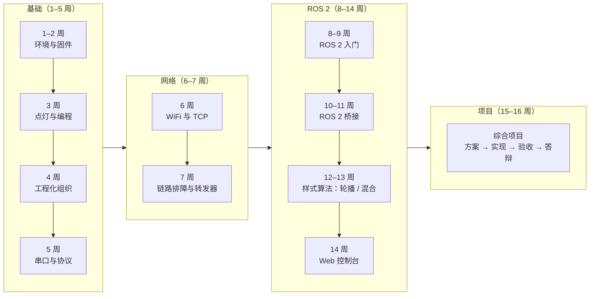

# 《ESP32 与 ROS 2 开发基础》课程包

面向**职业本科一年级**学生的软硬件入门课程（48 学时 / 3 学分）。

课程以一个真实项目——**LED 协同控制系统**（绿板 / 蓝板两块 ESP32-S3 + 学而思掌机，
经 WiFi/TCP 接入 WSL 中的 ROS 2，用 Web 控制台管理灯效）——为主线，学生从"点亮一颗灯"
开始，依次完成固件烧录、MicroPython 编程、串口与 WiFi 通信、ROS 2 桥接、Web 控制台，
最终以小组为单位完成一个可演示的软硬件通信作品。

> 课程设计取材于真实开发过程（含编译、部署、联调、排障的全部历史），
> 每个知识点都能在工程代码与 git 提交历史中找到对应实现，便于教师"边讲边演示"。

**另有短平快集训版**（2026-10-16 增补）：1 天教师教学 + 3–4 天自学实践，面向小学期 /
实训周 / 竞赛集训，两条硬目标——理解 ROS 2 应用流程 + 在教师监督下用 AI 工具完成本项目
的算法开发；见 [06-短平快集训方案.md](06-短平快集训方案.md) 与
[07-AI监督开发工作流.md](07-AI监督开发工作流.md)。

## 归档说明（rsp 工作区，2026-10-07）

- 来源仓库：`esp32s3_ros2_3board_1drvboard`（私有；本机开发副本 `C:\vibecoding\esp32s3`）。
  本目录是原仓库 `course/` 的归档（`01`–`05` 为原样副本），README 按 rsp 约定补了归档说明与路径适配；
  `06`、`07` 为 2026-10-16 在本工作区新增的短平快集训版，来源仓库没有这两份。
- 配套工程代码归档在 `教学demo/ESP32-ROS2-LED协同系统/`（`common/`、`green/`、`blue/`、
  `xrs/`、`tools/`、`ros2_ws/` 与两块板的 MicroPython 固件）。
- 讲义 deck：`教学webppt/ESP32与ROS2开发基础/`；文字版技术要点：`docs/ESP32与ROS2开发基础.md`。
- 一键下载（课程包 + 代码 + 固件）：`教学webppt/ESP32与ROS2开发基础/files/ESP32与ROS2课程包与代码.zip`。
- 课程包内出现的 `common/`、`green/`、`tools/`、`ros2_ws/` 等路径，都指上面的代码目录；
  `wifi_config.py` 含真实 WiFi 密码，不随包分发，模板见 `common/wifi_config.example.py`。

## 课程包文件

| 文件 | 内容 | 主要读者 |
|---|---|---|
| [01-课程标准.md](01-课程标准.md) | 课程定位、目标、内容、学时分配、课程思政、教学条件 | 教师、教学管理 |
| [02-教学单元设计.md](02-教学单元设计.md) | 16 周 × 3 学时逐次课的教案要点 | 教师 |
| [03-实验指导书.md](03-实验指导书.md) | 11 个实验的目的、步骤、验收、常见问题 | 教师、学生 |
| [04-考核方案.md](04-考核方案.md) | 过程性考核、实验评分、综合项目量规 | 教师、学生 |
| [05-教师手册.md](05-教师手册.md) | 学情分析、教学策略、设备清单、故障案例库 | 教师 |
| [06-短平快集训方案.md](06-短平快集训方案.md) | 1 天教师教学 + 3–4 天自学：日程、检查点、短版考核、应急预案 | 教师 |
| [07-AI监督开发工作流.md](07-AI监督开发工作流.md) | AI 四步工作法、提示词模板、算法任务卡 A/B/C、监督红线 | 教师、学生 |

## 课程主线（一张图）



## 快速开始

### 教师课前准备（约 30 分钟）

1. **准备实验环境**（学生机可统一装好镜像）：
   - Windows 10/11 + Python 3.10+
   - `python -m pip install esptool mpremote`
   - WSL2 Ubuntu 24.04 + ROS 2 Jazzy（可使用预装镜像；环境与课前清单见 [05-教师手册.md](05-教师手册.md) §三）
2. **准备硬件**：每组 2 块 ESP32-S3 N16R8 板（绿/蓝各一）+ 2 根 USB 数据线 + 一台无线路由器/手机热点。
3. **按实验一先做一遍全流程预演**，确认本机 COM 口、WiFi 密码、IP 地址与代码目录一致。

### 学生第一次上机（实验一）

```powershell
# 1. 探测开发板（把 COM13 换成"设备管理器"里 CH343 对应的端口）
python -m esptool --port COM13 --baud 460800 flash-id

# 2. 擦除并烧录 MicroPython（固件随课程包分发；路径按本工作区归档位置）
python -m esptool --port COM13 --baud 460800 erase-flash
python -m esptool --port COM13 --baud 460800 write-flash -z 0x0 "教学demo/ESP32-ROS2-LED协同系统/firmware/GENERIC_S3-20220618-v1.19.1.bin"
```

> 原仓库里这块固件位于厂商资料目录 `ESP32-S3开发板N16R8焊接/固件/`；本工作区已把该固件
> 一并归档到代码目录 `firmware/`，无需再找厂商压缩包。

## 与工程代码 / git 历史的对应关系

课程每个单元都能用真实提交做演示（提交号来自来源仓库 `esp32s3_ros2_3board_1drvboard`）：

| 课程内容 | 工程文件 | 参考提交（来源仓库 `git log`） |
|---|---|---|
| 点灯与串口标识 | `green/main.py`、`blue/main.py` | `2d2b027` |
| 公共/专用代码结构、一键部署 | `common/board_common.py`、`tools/deploy.py` | `3dd63a5` |
| 串口桥、ROS 2 包骨架 | `tools/serial_tcp_bridge.py`、`ros2_ws/src/board_bridge/` | `a2e1752` |
| WiFi/TCP 链路、心跳与转发 | `common/board_common.py`、`tools/tcp_forwarder.py` | `bbac4cd` |
| 样式 CRUD 与轮播、断线重连 | `common/board_common.py` | `52ddad6` |
| LED 控制台页面 | `ros2_ws/.../led_ui.py` | `35c6a63` |
| 并行混合 MIX | `common/board_common.py`、`led_ui.py` | `351c38c`、`8c1377b` |
| 文档与教学素材 | 课程包本目录 | — |

## 硬件与环境速记

- 开发板：ESP32-S3 N16R8（16 MB Flash / 8 MB PSRAM），板载 WS2812 RGB 接 **GPIO48**，BOOT 键接 GPIO0。
- USB 转串口：CH343，115200 波特率；两个板子同时插时按 CH343 端口逐个识别，用串口标识区分绿/蓝板。
- 第三块板（学而思掌机，ESP32-WROVER-B + ST7735S 屏）经 GD32 桥（"USB 串行设备"）部署，固件在代码目录 `xrs/firmware/`。
- 出厂固件是 ESP-IDF 演示程序（无 Python REPL），必须烧录 MicroPython 完整镜像（S3 烧到 **0x0**，掌机烧到 **0x1000**）。
- 工具必须用 `python -m esptool` / `python -m mpremote` 调用（Scripts 目录不在 PATH）。
- 运行期通信走 WiFi（无 COM）；COM 仅用于烧录、部署和调试日志。
- `common/wifi_config.py` 含真实 WiFi 密码，**不入库、不截图、不投屏**。

## 安全提示（第一节课必讲）

- 板子用 USB 5V 供电，逻辑电平 3.3V；不要用外接 5V 信号直接接 GPIO。
- 插拔 USB 前先松开手部静电（摸一下金属桌腿）；不要带电插拔杜邦线。
- RGB 灯默认亮度值很低（如 (0,100,0)），不要长时间设置 255 全亮，避免刺眼和发热。
- 机房里不要把路由器 WAN 口接入校园网；使用独立小路由或手机热点。
