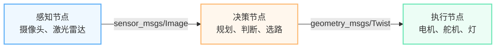
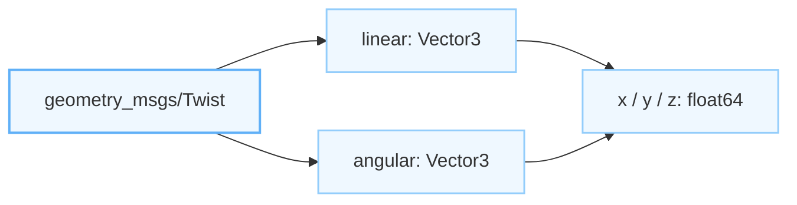
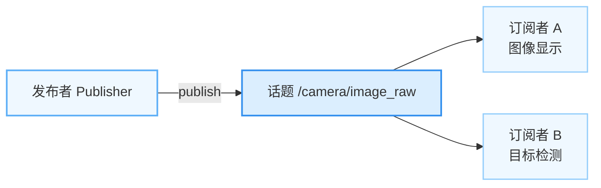
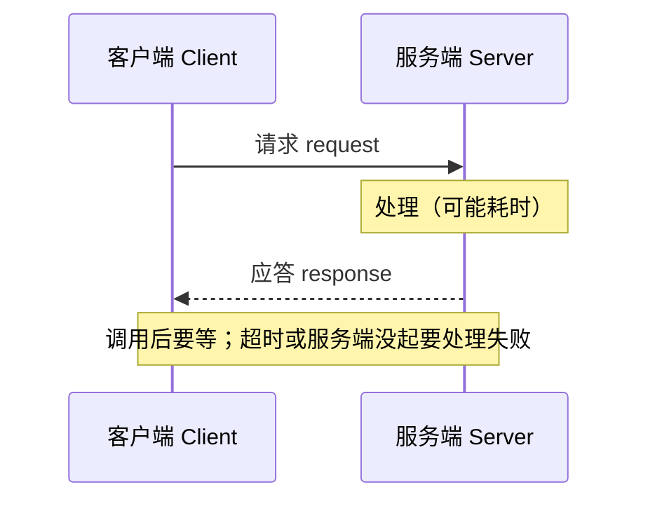
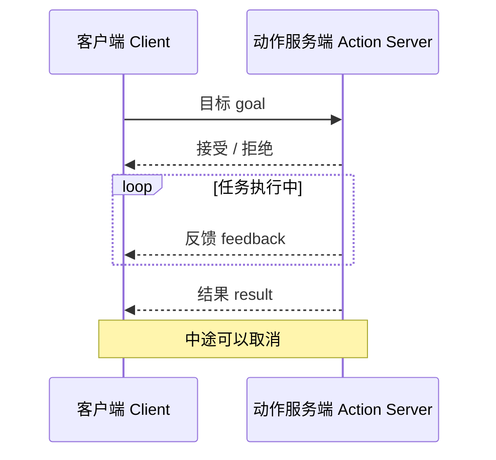
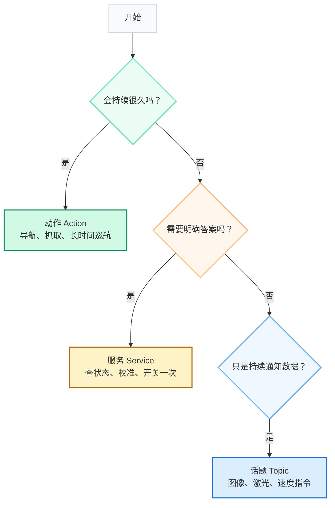

# ROS 2 通信三件套：话题、服务、动作（文字版教程）

> 先修课（第 0.2 册）。面向没有编程基础的学生，建议接在《编程零基础起步：从函数到回调》之后学，可与《ESP32 与 ROS 2 开发基础》并行。
>
> 对应 deck：[../index.html](../index.html)
> 图文要点：[../../../docs/ROS2通信三件套.md](../../../docs/ROS2通信三件套.md)

## 怎么用这本教程

先看三个生活场景，再看技术名；每读一节，回到口诀复述一遍。读完之后，打开 ROS 2 终端把第 13 节的三条命令各跑一次。

口诀：**传感器用话题、办事用服务、长活用动作。**

颜色编码：**蓝＝数据 / 硬件，橙＝请求 / 逻辑，绿＝完成 / 结果。**

## 1. 为什么机器人需要通信

机器人不是一个程序包打天下，而是拆成很多节点（Node）：有人看、有人想、有人动。节点之间不直接读对方内存，只通过消息交换数据。



要点：

- 每个节点只干一件事，出了问题容易定位。
- 节点可以在同一台电脑，也可以分布在树莓派、ESP32 和上位机上。
- 节点之间不共享内存；消息是唯一接口。
- 通信不是“附加功能”，而是机器人的骨架。

## 2. 消息：有格式的信封

消息（Message）像一张有格式的表格：字段名＋类型。发之前先约定这张表有哪些栏、每栏放什么类型。双方类型必须对上，否则等于听不懂。



常见消息：

| 消息类型 | 一句话 | 典型字段 |
| --- | --- | --- |
| `std_msgs/String` | 一句话 | `string data` |
| `sensor_msgs/Image` | 一张图像 | `height`、`width`、`encoding`、`data` |
| `geometry_msgs/Twist` | 速度指令 | `linear`、`angular`，各含 `x / y / z` |

类型名的写法是 **包名 / 类型名**。例如 `geometry_msgs/Twist` 是 `geometry_msgs` 包里的 `Twist` 类型。

记忆点：字段名告诉你“这栏放什么”，类型告诉你“这栏怎么读”。两边对不上，就像一个人说中文、一个人只会听英文。

## 3. 话题：广播

发布者（Publisher）把消息丢到话题上就走，不关心谁来听；订阅者（Subscriber）自己订阅。话题是异步、多对多的。



要点：

- 发完不管回复；没有订阅者也照发，消息直接丢掉，不报错。
- 一个话题可以有多个发布者、多个订阅者，各订阅者互不影响。
- 适合连续数据流：`/camera/image_raw`、`/scan`、`/odom`、`/cmd_vel`。
- 生活类比：校园广播站。主播对着话筒说完就走，谁在听、听了多少，广播站不负责。

什么时候用：传感器数据、状态广播、速度指令。你只想“把消息放出去”，不关心谁来接。

## 4. 服务：打电话

客户端（Client）发请求，服务端（Server）处理后回一个响应。服务是同步的：调用后要等对方答复；一对一。



要点：

- 请求里带参数，响应里带结果；一次调用只对应一次处理。
- 调用后客户端要等答复；服务端没起或处理超时，要按失败处理。
- 图像、激光这种高频数据流不要用服务；服务适合“办一件事”。
- 生活类比：打电话问“现在电量多少？”对方查一下再告诉你；问完要等，不能不等人说完就挂。

什么时候用：查状态、校准、开关一次、读取一个配置。你要一个明确答案，而且能等。

## 5. 动作：点外卖

客户端发目标（goal），服务端持续反馈（feedback），最后给结果（result）。动作适合过程长、要进度、可取消的任务。



要点：

- 目标 goal：下单，说清楚“去哪里、抓什么”。
- 反馈 feedback：配送进度，走了多少、到哪了。
- 结果 result：送达或失败，任务结束时给一个明确结论。
- 中途可以取消；这是它和服务最大的区别。
- 生活类比：点外卖。下单后有骑手位置，送到有结果，等太久还能取消。

什么时候用：导航到某个点、机械臂抓取、长时间巡航、跟随。任务要跑一阵子，你还想中途知道进度、必要时叫停。

## 6. 三件套对比

| 维度 | 话题 Topic | 服务 Service | 动作 Action |
| --- | --- | --- | --- |
| 数据方向 | 单向广播 | 请求＋应答（双向） | 目标＋反馈＋结果（多段） |
| 是否等结果 | 不等：发完就走 | 等：同步调用 | 不等最终结果，但可持续收反馈 |
| 典型时长 | 毫秒级连续数据流 | 秒级以内的一次处理 | 秒到分钟，甚至更长 |
| 能否取消 | 没有“取消”这个概念 | 一般不能中途取消 | 可以取消 |
| 参与者 | 多对多 | 一对一 | 一对一线程式任务 |
| 典型场景 | 图像、激光、速度指令 | 查状态、校准、开关 | 导航到点、机械臂抓取 |

一句话：**话题“发完不管”，服务“问完就等”，动作“派活能催能撤”。**

判断顺序：

1. 会持续很久吗？是 → 动作。
2. 需要明确答案吗？是 → 服务。
3. 只是持续通知数据？是 → 话题。



## 7. 消息系统细节

消息类型由 `.msg` 文件定义：一行一个字段，写法是“类型 名字”。字段可以嵌套另一个消息类型。

```text
# geometry_msgs/msg/Twist.msg
Vector3 linear
Vector3 angular

# Vector3.msg
float64 x
float64 y
float64 z
```

用一条命令看结构：

```bash
ros2 interface show geometry_msgs/msg/Twist

# 输出（节选）
geometry_msgs/Vector3 linear
geometry_msgs/Vector3 angular
```

为什么不能随便改：

- 字段名、类型、顺序一改，消息就变了。
- 发布者和订阅者必须用同一版定义，否则解析错位或收不到。
- 类型名相同还不够：字段名、字段类型、顺序都要一致。

常见错误：发布者用 `String`，订阅者却按 `Twist` 解析；或者发布者加了字段、订阅者没更新。这不是网络问题，是格式问题。

## 8. 代码里长什么样

只要求认得出，不要求会写。

```python
# 话题：发布者
from std_msgs.msg import String

pub = self.create_publisher(String, '/hello', 10)
pub.publish(String(data='hi'))
```

```python
# 服务：服务端 / 客户端
from example_interfaces.srv import AddTwoInts

server = self.create_service(AddTwoInts, '/add', cb)
future = self.cli.call_async(AddTwoInts.Request(a=1, b=2))
```

```python
# 动作：客户端
from nav2_msgs.action import NavigateToPose

self.cli = ActionClient(self, NavigateToPose, '/navigate_to_pose')
self.cli.send_goal_async(goal)
```

一眼分辨：

- `publish` 是广播，对应话题。
- `call` 是打电话，对应服务。
- `goal` 是下单，对应动作。

## 9. 常见坑

| 坑 | 现象 | 排查 |
| --- | --- | --- |
| 话题没有订阅者也照发 | `publish()` 不报错，消息直接丢掉 | `ros2 topic info <话题>` 看订阅者数量 |
| 服务调用超时 / 对方没起 | 客户端一直等或超时 | `ros2 service list` 确认服务端在，检查服务名 |
| 动作忘了等结果 | 下一步在任务还没开始时执行 | 等 goal 被接受，再等 result |
| QoS 配错 | 数据可能丢或收不到 | 可靠 reliable 与尽力 best effort 要匹配 |

QoS 一句话：可靠（reliable）保证送到，尽力（best effort）可能丢；传感器常用 best effort，控制指令常用 reliable。知道有这回事即可。

排查顺序：先列出来（`list`）→ 再看一眼（`echo` / `info`）→ 最后才怀疑代码。

记住：**“没报错”只说明程序跑到了这一行，不说明对方收到了。**

## 10. 记忆锚

| 颜色 | 通信 | 生活类比 | 一句话 |
| --- | --- | --- | --- |
| 蓝 · 数据 / 硬件 | 话题 Topic | 广播 | 一个喊，谁想听谁订阅；发完不管 |
| 橙 · 请求 / 逻辑 | 服务 Service | 打电话 | 问一句，等一句；必须等结果 |
| 绿 · 完成 / 结果 | 动作 Action | 点外卖 | 下单、看进度、送达；可取消 |

口诀：**传感器用话题、办事用服务、长活用动作。**

三个关键词：

- 话题：`publish`、`subscribe`
- 服务：`request`、`response`
- 动作：`goal`、`feedback`、`result`

## 11. 对比决策：先学三种，还是先把话题跑通

| 维度 | 先学三种 | 先跑通话题 |
| --- | --- | --- |
| 起步速度 | 慢：三种同时上手，命令和概念一起压过来 | 快：一条 `ros2 topic echo` 当天就能看到数据 |
| 概念负担 | 容易混：三套接口、三种回调一起记 | 单一：先把发布/订阅的直觉建立起来 |
| 调试手段 | 三种都要会：echo、call、action 各一套 | 话题工具最直观：list / echo / info 就能排障 |
| 适合人群 | 要系统梳理、准备考试或做接口设计 | 零基础、项目驱动、先要看到现象 |
| 主要风险 | 边界没建立就先背接口，越学越乱 | 容易把服务/动作也硬套成话题，需要后续补边界 |

本课程立场：**先用话题跑通一条数据流，再补服务与动作。**

引导问题：你今天是先要看到数据在流动，还是要一次把三种背清楚？要看到现象就先跑话题；要设计接口再系统补三种。

## 12. 行动清单

开一个 ROS 2 终端，三条命令各试一次：

```bash
ros2 topic list
ros2 topic echo /rosout --once
ros2 service list
ros2 action list
```

每条命令记一句：

- 话题：看到了哪些名字？挑一个 echo 出了什么字段？
- 服务：有几个？名字里有没有 get / set / calibrate？
- 动作：有几个？名字里有没有 navigate / grab / follow？

如果 `ros2 action list` 为空，说明当前没有动作服务器，不是命令错。

## 13. 五分钟自测

1. 话题：发布者要不要等订阅者回复？
2. 服务：调用后能不能不等结果就继续？
3. 动作：中间进度叫什么？能不能取消？
4. 消息：两边类型对不上会发生什么？
5. 判断：导航到某点，用话题、服务还是动作？

参考答案：

1. 不等，发完就走。
2. 不能，服务是同步的，要等应答。
3. 叫反馈 feedback；可以取消。
4. 订阅者“听不懂”，消息解析失败；这不是网络问题。
5. 用动作 Action，因为它耗时长、要进度、可取消。

## 14. 下一步

下一册《ESP32 与 ROS 2 开发基础》用真实硬件把话题、服务、动作跑起来：三块 ESP32-S3 / 掌机经 WiFi 接入 ROS 2，完成点灯、通信与订阅。

本册只建立边界感；先有数据流，再补边界，最后上板子。

> 传感器用话题、办事用服务、长活用动作。
> 蓝广播、橙电话、绿外卖。
