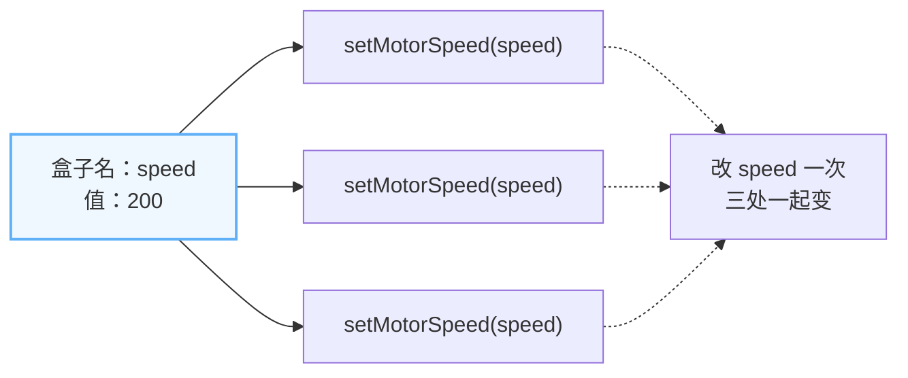
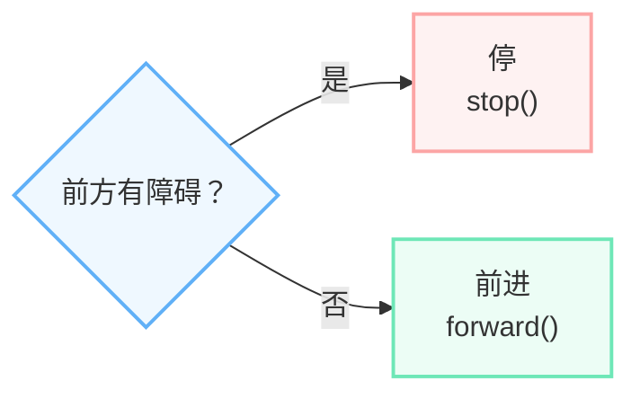
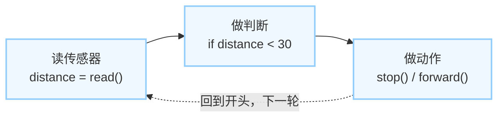
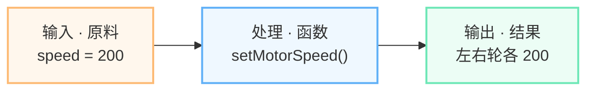
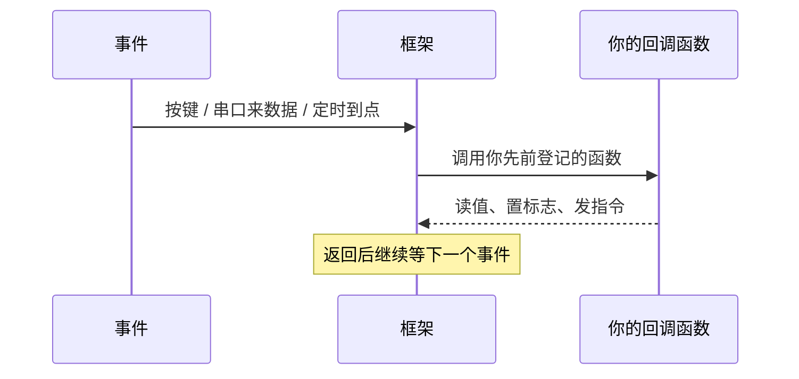
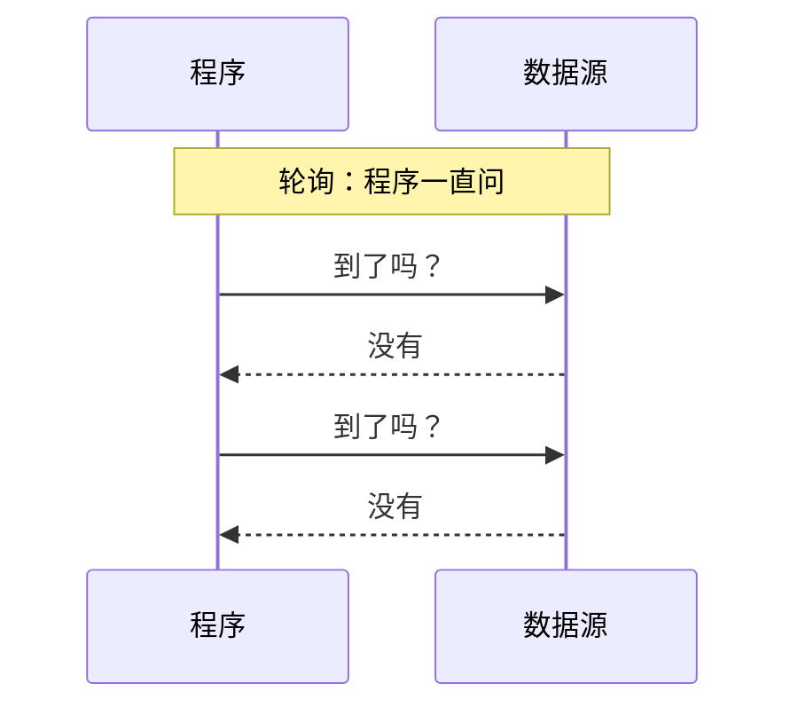
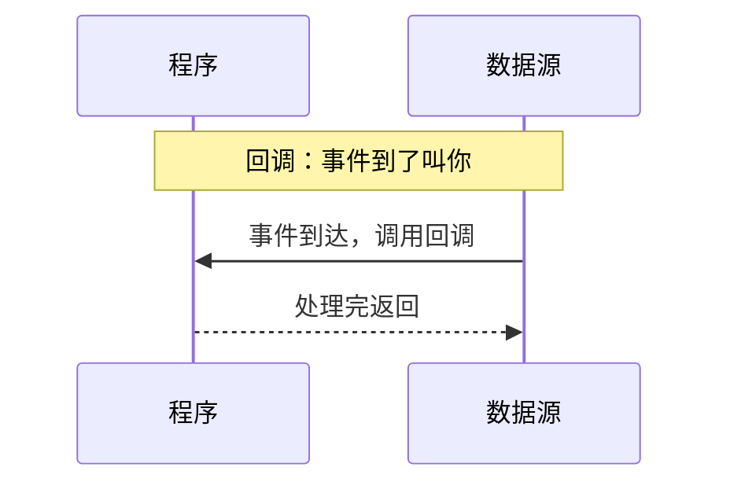
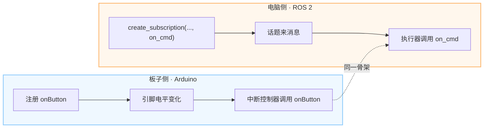
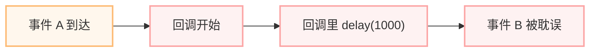

# 编程零基础起步：从函数到回调（文字版教程）

> 先修课 · 第 0 册。面向没有编程基础的学生，建议在《ESP32 与 ROS 2 开发基础》之前学。
>
> 返回 deck：[../index.html](../index.html)  
> 图文要点：`docs/编程零基础起步.md`

## 写在前面

你不需要先学完一门编程语言，也不需要背语法表。本册只做一件事：**让你看懂机器人程序里最常见的 5 个最小概念，并且敢动手改。**

这 5 个概念是：

1. 变量（variable）
2. 条件（condition）
3. 循环（loop）
4. 函数（function）
5. **回调（callback）**——本册的重点

学习方式只有三步：**抄一段、改一个数、看它变**。先让程序跑起来，再回头补原理。

> 一句话结论：编程不可怕，会照着改，就先成功一半。

---

## 1. 五个概念怎么拼起来


可以这样理解：

- **变量**是盒子，里面放数据；
- **条件**是岔路口，真走一条、假走另一条；
- **循环**是值班表，同一套动作一遍遍做；
- **函数**是配方，把一段动作打包起来重复用；
- **回调**是门铃，事件来了，框架替你把函数叫起来。

前四个是积木，回调是让积木在正确时机自动启动的开关。

---

## 2. 变量：贴了名字的盒子

### 2.1 一句话

变量就是「贴了名字的盒子」。`speed = 200` 的意思是：把 200 放进名为 `speed` 的盒子。



```python
speed = 200          # 把 200 放进 speed 这个盒子
setMotorSpeed(speed) # 用盒子里的值，而不是再写一遍 200
```

### 2.2 为什么名字比数字好改

假设程序里有 20 处 `200`，你想把速度改成 100：

- 不用变量：要找出 20 处，一处处改，漏一处就出问题；
- 用变量：只改 `speed = 100` 这一处，所有用到 `speed` 的地方一起变。

这就是变量最大的好处：**给数据起名字，改一处，处处跟着变。**

### 2.3 两个符号别混

| 符号 | 读法 | 作用 | 例子 |
| --- | --- | --- | --- |
| `=` | 放进去 | 赋值 | `speed = 200` |
| `==` | 相不相等 | 比较 | `if speed == 200:` |

初学者最常见的错，是在判断里把 `==` 写成了 `=`。记住：**一个等号是放，两个等号是问。**

### 2.4 命名的三个小习惯

- 名字写「它是什么」：`speed`、`distance`、`threshold`、`stop_flag`。
- 同一个名字只放一类值：速度别一会儿放 200，一会儿放「前方有障碍」。
- 先赋值再使用：盒子还没放东西就读，程序会报错或读到奇怪的值。

---

## 3. 条件：红绿灯式二选一

### 3.1 一句话

条件只回答一个问题：**真，还是假。** 真就走一条路，假就走另一条路。



```python
if distance < 30:
    stop()
else:
    forward()
```

读法：「如果 距离小于 30，就 停；否则 前进。」

### 3.2 缩进就是范围

缩进的行属于 `if`；没缩进的行已经出了判断。

```python
if distance < 30:
    stop()        # 只有条件为真才执行
forward()         # 不管条件真假，都会执行
```

新手常犯的错，是把「不管怎样都要做」的动作缩进了 `if` 里面，结果条件为假时它就不做了。

### 3.3 常用比较符

| 写法 | 意思 | 例子 |
| --- | --- | --- |
| `<` | 小于 | `distance < 30` |
| `>` | 大于 | `speed > 100` |
| `==` | 等于 | `state == 1` |
| `!=` | 不等于 | `state != 0` |

条件不是「让机器思考」，而是你提前替它把两条路都写好。

---

## 4. 循环：机器人程序几乎都住在循环里

### 4.1 一句话

传感器每时每刻都在变，程序不能跑一遍就结束；读 → 判断 → 动作，一轮接一轮。



```python
while True:
    distance = read_distance()
    if distance < 30:
        stop()
    else:
        forward()
```

`while True` 的意思是：只要程序还在运行，就一直重复大括号 / 缩进里的内容。

### 4.2 为什么机器人必须循环

- 这次没障碍，不代表下一秒也没有；
- 机器人要一直值班，不能「跑完一次就下班」；
- 每一轮都要重新读传感器，不能拿旧数据做新决定。

### 4.3 循环里别死等

长 `delay()` 或长循环会让机器人「看不见」这段时间。比如你写了 `delay(1000)`，这 1 秒内：

- 按键按了，没人处理；
- 串口来数据了，没人接收；
- 新的障碍出现了，程序还在等。

要等，也用状态机或定时器，而不是把整个程序堵住。

---

## 5. 函数：配方 / 工具

### 5.1 一句话

把一段常用动作打包，起个名字；以后给不同的原料，就能重复用。



```python
def setMotorSpeed(speed):
    left_motor.run(speed)
    right_motor.run(speed)

setMotorSpeed(200)   # 调用：把 200 作为原料交给函数
```

### 5.2 三个词就够

| 词 | 意思 | 例子 |
| --- | --- | --- |
| 函数名 | 这个工具叫什么 | `setMotorSpeed` |
| 参数 | 你给它什么原料 | `200` |
| 返回值 | 它交给你什么结果 | 有的函数有，有的没有 |

本册先盯前两个：**会调用、会改参数**。函数体先照抄，不要求你独立写。

### 5.3 为什么要用函数

- 同一段动作只写一次，到处调用；
- 改配方只改函数内部，不用到处找；
- 名字就是说明书，看到 `setMotorSpeed` 就知道它干什么。

> 函数我来调——这是全册口诀的前半句。

---

## 6. ★ 回调：不是你调它，是事件来叫它

这是本册最重要的概念。先记住一个生活场景：

> 门铃响 → 你起身 → 开门。

代码里就是：

> 事件发生 → 框架调用你写好的函数。

### 6.1 三个角色

| 角色 | 是谁 | 做什么 |
| --- | --- | --- |
| 事件 | 按键、串口来数据、定时到点、话题来消息 | 告诉框架「有事发生了」 |
| 框架 | Arduino、ROS 2、操作系统、串口库 | 负责等事件，事件来了调用你的函数 |
| 你的函数 | 你写的 `on_button` / `on_cmd` | 处理事件，处理完马上返回 |

你只负责写函数、登记函数；等事件是框架的事。

### 6.2 回调时序



五步记法：

1. 事件发生；
2. 框架收到；
3. 框架调用你登记的函数；
4. 你的函数干活；
5. 返回，框架继续等下一个事件。

### 6.3 门铃类比

| 生活 | 代码 |
| --- | --- |
| 门铃响 | 事件发生 |
| 你起身 | 框架调用 |
| 开门 | 你的回调函数执行 |
| 一直站门口问「有人吗」 | 轮询（不是回调） |

你不是一直站在门口问「有人吗」；你是在屋里干别的，门铃响了才起身。这就是回调。

### 6.4 最小代码样子

```python
def on_button():      # 你写的函数
    pressed = True

register(on_button)   # 交给框架登记
# 事件来了，框架替你调 on_button()
```

注意最后一行：`on_button` 后面没有括号。它的意思是「把这个函数交给框架」，而不是「现在就执行它」。真正执行它的，是事件发生时的框架。

### 6.5 一句话口诀

> **函数我来调，回调他来调。**

- 我主动写名字调用的是函数；
- 事件来了由框架调用的是回调。

---

## 7. ★ 回调 vs 轮询

两种方式都能拿到数据，区别在「谁掌握节奏」。

### 7.1 轮询：一直问



轮询就是写一个循环，反复问「到了吗？」「有数据吗？」「按键按了吗？」。

优点：直白，初学者容易理解。  
缺点：一直问，没事也占 CPU；问的间隔长，响应就慢。

### 7.2 回调：到了叫你



回调就是：你先把函数交给框架，然后去干别的；事件到了，框架叫你。

优点：没事时不占 CPU，事件一到就能响应。  
缺点：要多想一步——「这个函数谁来调？什么时候调？」

### 7.3 四个维度对比

| 维度 | 轮询 | 回调 |
| --- | --- | --- |
| 响应速度 | 看问的间隔；间隔长就慢 | 事件一到就叫，通常更快 |
| CPU 占用 | 一直问，没事也白转 | 没事时不占，事件来了才跑 |
| 写法难度 | 直白：一个循环问到底 | 要多想一步：函数谁来调 |
| 适用场景 | 简单脚本、状态变化慢、教学演示 | 按键、串口、传感器中断、ROS 2 订阅 |

轮询不是错，只是要看场合。按键、串口、ROS 2 订阅更适合回调；简单脚本、状态变化慢的场合，轮询也够用。

---

## 8. ★ 同一个回调，两种现场

回调不是某一种语言或某一块板子的专利。板子侧和电脑侧，骨架完全一样。



### 8.1 板子侧：Arduino 中断

```cpp
attachInterrupt(
  digitalPinToInterrupt(2),
  onButton,
  FALLING);

void onButton() {
  pressed = true;   // 只置标志，马上返回
}
```

- 事件：引脚 2 的电平发生变化；
- 谁调用：中断控制器；
- 你的函数：`onButton`；
- `FALLING`：下降沿触发，也就是电平从高变低时触发。

### 8.2 板子侧：串口接收回调

串口收到数据时，框架也可以调用你写的函数。不同平台写法不同，但骨架一样：先登记函数，数据来了框架叫你。

### 8.3 电脑侧：ROS 2 订阅

```python
self.create_subscription(
  String, 'cmd', self.on_cmd, 10)

def on_cmd(self, msg):
    self.last = msg.data
```

- 事件：话题 `cmd` 来了一条消息；
- 谁调用：ROS 2 的执行器（executor）；
- 你的函数：`on_cmd`；
- `10`：消息队列长度。

### 8.4 电脑侧：ROS 2 定时器

```python
self.create_timer(0.5, self.on_timer)
```

- 事件：每 0.5 秒到点；
- 谁调用：ROS 2 执行器；
- 你的函数：`on_timer`。

### 8.5 两种现场对照

| 现场 | 事件 | 谁调用你的函数 | 常见名字 |
| --- | --- | --- | --- |
| 板子侧 | 引脚电平变化、串口来数据 | 中断控制器 / 串口框架 | 中断回调、串口接收回调 |
| 电脑侧 | 话题来消息、定时器到点 | 执行器（executor） | 订阅回调、定时器回调 |

换的是现场，不换的是「框架替你叫函数」。

---

## 9. 回调的坑：别在里面死等

### 9.1 为什么不能死等

回调不是「你的私人函数」，它运行在框架的线程 / 循环里。你一堵，别人也走不动。



### 9.2 错误写法

```cpp
void onButton() {
  delay(1000);       // 框架被卡住 1 秒
  motor.stop();
}
```

这 1 秒里，别的按键、串口数据、定时器都可能被耽误；事件越多，堵得越明显。

### 9.3 正确写法

```cpp
volatile bool stopFlag = false;

void onButton() {
  stopFlag = true;   // 只记一笔，马上返回
}

void loop() {
  if (stopFlag) {
    motor.stop();
    stopFlag = false;
  }
}
```

回调只做三件事：**收下、记下、马上返回**。重活交给主循环或状态机。

### 9.4 三条红线

- 不 `delay()` / `sleep()`；
- 不写长时间 `for` / `while`；
- 不在回调里做慢速网络请求或大段打印。

ROS 2 里同理：回调只存消息 / 置标志，处理放到定时器或主循环。

---

## 10. 记忆锚：一句口诀、一个门铃、四种颜色

| 钩子 | 内容 | 怎么用 |
| --- | --- | --- |
| 口诀 | **函数我来调，回调他来调** | 我主动写名字调用的是函数；事件来了由框架调用的是回调 |
| 门铃类比 | 门铃响 → 你起身 → 开门 | 门铃＝事件，起身＝框架调用，开门＝回调函数 |
| 颜色编码 | 蓝＝框架 / 板子侧；橙＝你写的代码 / 电脑侧；黄＝事件；绿＝验证通过 | 全册统一，看到颜色就知道角色 |

> 函数我来调，回调他来调；门铃一响，框架叫你。

先想起钩子，再说出定义——这比逐字背概念更稳。

---

## 11. 先背语法，还是先跑通再回头补？

| 维度 | 先背语法 | 先跑通再回头补 |
| --- | --- | --- |
| 起步速度 | 慢：要背完才敢动 | 快：当天就能看到现象 |
| 记忆效果 | 脱离场景，容易忘 | 挂在现象上，记得住 |
| 遇到新问题 | 容易卡在「这个没学过」 | 会查、会改、会验证 |
| 适合人群 | 有考试大纲、时间充裕、要系统打底 | 零基础、项目驱动、先建立信心 |
| 主要风险 | 背完不会用，挫败感高 | 基础不牢，需要安排回头补 |

引导问题：你今天的硬目标是哪一种？

- 要考试默写 → 先背语法；
- 要让轮子转起来、让消息通 → 先跑通最小闭环，再回头补。

本课程立场：**先跑通、边做边补**；每跑通一次，回头补一个概念。

---

## 12. 今天就能做的 3 件事

### 12.1 抄一段

把下面的伪代码抄进编辑器，先让它不报错；抄的时候把每一行读成一句人话。

```python
speed = 200
stop_flag = False

def on_button():        # 回调：事件来了框架叫你
    stop_flag = True

register(on_button)     # 先登记，等事件

while True:             # 循环：一直值班
    distance = read_distance()
    if stop_flag or distance < 30:   # 条件：真 / 假
        stop()
    else:
        setMotorSpeed(speed)         # 函数：给参数
```

逐行读：

- `speed = 200`：变量，盒子 `speed` 里放 200；
- `stop_flag = False`：变量，记录「有没有人按了停」；
- `def on_button():`：函数，定义回调；
- `stop_flag = True`：回调里只置标志，马上返回；
- `register(on_button)`：把回调登记给框架；
- `while True:`：循环，一直值班；
- `distance = read_distance()`：读传感器；
- `if stop_flag or distance < 30:`：条件，两个条件满足一个就停；
- `setMotorSpeed(speed)`：函数，给参数。

### 12.2 改一个数

- 把 `speed = 200` 改成 100 或 300；
- 把 `distance < 30` 改成 50；
- 一次只改一个地方。

### 12.3 看它变

记录「改前 / 改后」各一句：

- 哪一行改了？
- 现象怎么变？
- 为什么？

能说出来，才算真的跑通。

> 把「看懂了」变成「我改了，它真的变了」——这一步跨过去，编程就入门了。

---

## 13. 五分钟自测

1. 变量：`speed = 200` 的盒子名和值各是什么？
2. 条件：`if distance < 30` 为真时走哪条路？
3. 循环：机器人为什么不能跑一遍就结束？
4. 函数：`setMotorSpeed(200)` 的原料是什么？
5. 回调：谁调用你写的回调函数？

参考答案：

1. 盒子名是 `speed`，值是 200。
2. 走「停」这条路，执行 `stop()`。
3. 传感器每时每刻都在变，机器人要一直值班。
4. 原料是 200，也就是参数 `speed`。
5. 事件发生时的框架（Arduino 中断控制器 / ROS 2 执行器）调用，不是你直接调用。

---

## 14. 下一册

本册只建立最小概念。下一册《ESP32 与 ROS 2 开发基础》会用真实硬件把它们跑起来：

- 点灯、联网、发消息；
- 把变量、条件、循环、函数放进板子程序；
- 用回调处理按键、串口数据和 ROS 2 订阅；
- 走通「设备层 → 通信层 → 系统层」一条链。

先有概念，再上板子；先跑通，再补原理。

---

## 下载与返回

- 返回 deck：[../index.html](../index.html)
- 图文要点：`docs/编程零基础起步.md`
- 下一册：`教学webppt/ESP32与ROS2开发基础/index.html`

> 函数我来调，回调他来调——门铃一响，框架叫你。
